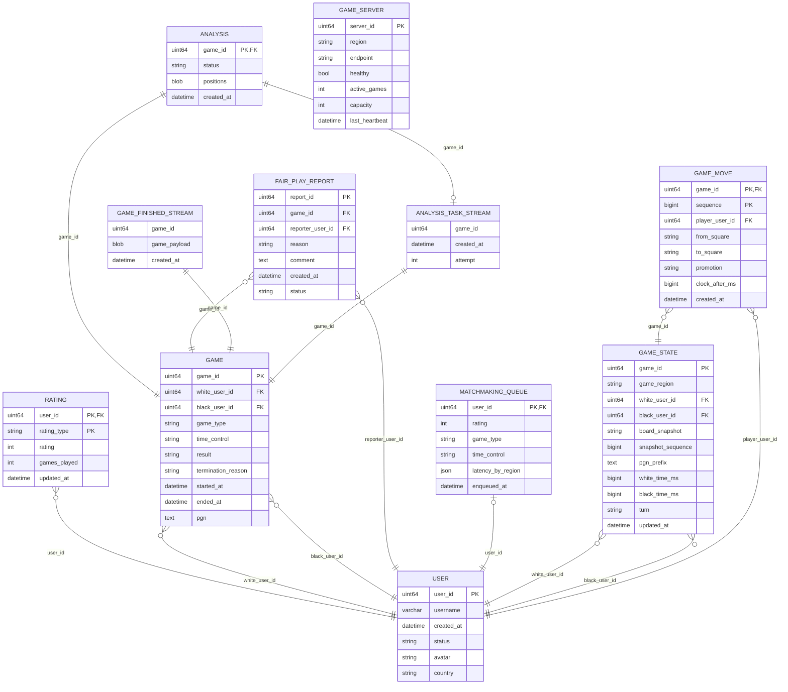

# Проектирование высоконагруженной платформы онлайн-шахмат

## 1. Тема и целевая аудитория

### 1.1. Тема

Проектируется сервис для игры в шахматы онлайн.

Основной аналог - **Chess.com**. Также к сервисам этого типа относится Lichess.

В работе рассматривается только основной игровой функционал. Обучение, боты, трансляции, клубы и другие дополнительные возможности Chess.com в проект не входят.

### 1.2. Целевая аудитория

Chess.com - глобальный сервис.

По отчёту Chess.com за II квартал 2026 года средняя дневная аудитория составляет **10,2 млн DAU**. На 30 июня 2026 года в сервисе было зарегистрировано более **267 млн пользователей** [[1]](#source1).

По данным официальной страницы Chess.com, месячная аудитория сервиса составляет более **50 млн пользователей в месяц** [[2]](#source2).

Аудитория распределена по всему миру. По данным Chess.com за июнь 2026 года, только на США и Индию приходится **84 млн зарегистрированных пользователей**, то есть примерно треть всей пользовательской базы. В России зарегистрировано 8,1 млн пользователей [[3]](#source3).

Для проектирования принимается глобальная аудитория Chess.com.

| Метрика | Значение |
| --- | ---: |
| MAU | 50+ млн |
| Средний DAU | 10,2 млн |
| Зарегистрированные пользователи | 267+ млн |
| География | Международная |

### 1.3. Функционал MVP

В MVP входят основные функции, необходимые для онлайн-игры:

1. Поиск соперника (матчмейкинг с учетом рейтинга пользователя).
2. Проведение партии - сервер принимает ходы, проверяет их и передаёт состояние партии сопернику.
3. Завершение партии (с пересчетом рейтинга и анализом партии).
4. Анализ партии - подсчет точности, подбор лучших ходов в каждой позиции (проводит серверная модель Stockfish).
5. Жалоба на нечестную игру.
6. Просмотр истории партий (с поиском по сопернику, виду партии, контролю времени).

### 1.4. Ключевые продуктовые решения

- Ходы передаются между игроками в реальном времени.
- Шахматные часы считаются на сервере, а не на клиенте.
- Одна завершённая партия хранится один раз и связывается с обоими игроками.
- Анализ сыгранной партии производится 1 раз и хранится.
- Матчмейкинг учитывает рейтинг игрока и выбранный контроль времени.

---

## 2. Расчёт нагрузки

Основные данные Chess.com за 2 квартал 2026 года [[1]](#source1):

- **10,2 млн DAU**;
- **2,8 млрд игр за квартал**;
- **380+ игр/с в пике**;
- **540+ млрд обработанных запросов за квартал**;
- **3,3 млн Fair Play reports за квартал**.

Chess.com не публикует долю игр отдельно от игр с ботами. Поэтому 2,8 млрд используется как верхняя оценка нагрузки.

### 2.1. Продуктовые метрики

#### Аудитория

| Метрика | Значение |
| --- | ---: |
| MAU | 50+ млн [[2]](#source2) |
| Средний DAU | 10,2 млн [[1]](#source1) |
| Зарегистрированные пользователи | 267+ млн [[1]](#source1) |

#### Игры и действия пользователя

Среднее количество партий в сутки (во 2 квартале 2026 года 91 день):

```text
2,8 млрд / 91 = 30,77 млн партий/сутки
```

В одной партии участвуют два игрока:

```text
30,77 млн × 2 / 10,2 млн DAU = 6,03 партии на активного пользователя в день
```

Для расчёта количества ходов принимается стандартная для Chess.com расчётная длина партии — **40 полных ходов**, то есть около **80 полуходов** [[5]](#source5).

```text
30,77 млн × 80 = 2,462 млрд ходов/сутки
```

На одного DAU:

```text
2,462 млрд / 10,2 млн = 241,3 хода/сутки
```

Fair Play:

```text
3,3 млн / 91 = 36,3 тыс. жалоб/сутки
```

```text
36,3 тыс. / 10,2 млн = 0,00356 жалобы на DAU в день
```

Анализ партии - продуктовое решение проекта: **каждая завершённая партия анализируется один раз**, результат сохраняется. Game Review на Chess.com также выполняется на сервере с использованием Stockfish [[6]](#source6).

| Действие | На одного DAU в день | Всего в сутки |
| --- | ---: | ---: |
| Участие в партии | 6,03 | 61,54 млн |
| Отправка хода | 241,3 | 2,462 млрд |
| Завершение партии | 3,02 | 30,77 млн |
| Анализ партии | — | 30,77 млн |
| Fair Play report | 0,00356 | 36,3 тыс. |

#### Просмотр истории и анализа

Chess.com не публикует частоту таких запросов.

Для проектируемого API принимается:

- после завершения партии каждый игрок один раз обновляет историю;
- после готовности анализа каждый игрок один раз получает его результат.

Получаем по две операции чтения на одну завершённую партию:

```text
30,77 млн × 2 = 61,54 млн запросов/сутки
```

для истории и столько же для получения анализа.

### 2.2. Средний объём хранения пользователя

Chess.com сообщает о базе из **30+ млрд партий** [[4]](#source4).

Размер внутренней записи Chess.com не опубликован. Для оценки используется открытый PGN-дамп Lichess. За июнь 2026 года в нём:

- **86 483 328 партий**;
- архив занимает **28,2 ГБ**;
- распакованный PGN примерно в **7,1 раза больше** [[7]](#source7).

Средний логический размер одной партии:

```text
28,2 ГБ × 7,1 / 86 483 328 ≈ 2,315 КБ
```

Объём 30 млрд партий:

```text
30 млрд × 2,315 КБ ≈ 69,45 ТБ
```

Среднее число партий в истории одного зарегистрированного пользователя:

```text
30 млрд × 2 / 267 млн ≈ 224,7 партии
```

Так как одна партия хранится один раз и связывается с двумя игроками, нормированный объём архива на аккаунт:

```text
69,45 ТБ / 267 млн ≈ 0,000260 ГБ ≈ 0,260 МБ
```

#### Результаты анализа

Размер результата анализа Chess.com не публикуется, поэтому используется формат проектируемого сервиса.

Для каждой позиции сохраняются:

- оценка позиции;
- класс сыгранного хода;
- лучший ход;
- линия Stockfish примерно на 12 полуходов.

При анализе примерно 80 позиций полезная нагрузка результата анализа принимается равной **≈2,5 КБ** на партию. Это проектный формат хранения, а не значение Chess.com.

```text
30 млрд × 2,5 КБ ≈ 75 ТБ
```

Итого для основных данных MVP:

| Тип данных | Количество | Логический объём |
| --- | ---: | ---: |
| Партии | 30+ млрд | ≈69,45 ТБ |
| Анализы партий | 30+ млрд | ≈75 ТБ |
| **Итого** | — | **≈144,45 ТБ** |

В среднем на зарегистрированный аккаунт:

```text
144,45 ТБ / 267 млн ≈ 0,000541 ГБ ≈ 0,541 МБ
```

Это **логический объём данных**. Репликация, индексы, резервные копии и служебные данные здесь не учитываются.

Прирост в сутки:

```text
Партии:
30,77 млн × 2,315 КБ ≈ 71,2 ГБ/сутки

Анализы:
30,77 млн × 2,5 КБ ≈ 76,9 ГБ/сутки

Итого ≈ 148,1 ГБ/сутки
```

### 2.3. API и RPS

Для среднего RPS:

```text
RPS = число операций в сутки / 86 400
```

Средняя скорость создания партий:

```text
30,77 млн / 86 400 = 356,1 партии/с
```

Chess.com публикует пик **380+ игр/с** [[1]](#source1).

Коэффициент пиковой нагрузки:

```text
Kpeak = 380 / 356,1 ≈ 1,067
```

#### Клиентское API и WebSocket

| Операция | Направление | Что делает | Операций в сутки | Средняя частота | Пик |
| --- | --- | --- | ---: | ---: | ---: |
| `POST /matchmaking/search` | клиент → сервер | Ставит игрока в очередь | 61,54 млн | 712 RPS | 760+ RPS |
| `WS game.move` | клиент → сервер | Передаёт ход | 2,462 млрд | 28 490 EPS | 30 400+ EPS |
| `WS game.end` | сервер → клиент | Передаёт результат и причину завершения: мат, сдача, время, ничья | 61,54 млн | 712 EPS | 760+ EPS |
| `WS game.resign` | клиент → сервер | Игрок сдаётся | ≤30,77 млн | ≤356 EPS | ≤380 EPS |
| `GET /games/history` | клиент → сервер | Возвращает историю с фильтрами | 61,54 млн* | 712 RPS | 760+ RPS |
| `GET /games/{id}/analysis` | клиент → сервер | Возвращает сохранённый анализ | 61,54 млн* | 712 RPS | 760+ RPS |
| `POST /fair-play/reports` | клиент → сервер | Создаёт жалобу | 36,3 тыс. | 0,42 RPS | — |

\* Для истории и анализа принято по одному запросу от каждого игрока после завершения партии.

`game.resign` имеет только верхнюю границу: в одной партии сдаться может не более одного игрока. Доля партий, завершённых сдачей, Chess.com не публикуется.

Мат определяется сервером после `game.move`. Отдельного клиентского запроса для мата нет. После любого завершения сервер отправляет обоим игрокам `game.end`.

Входящий поток без `game.resign`:

```text
712 + 28 490 + 712 + 712 + 0,42 ≈ 30 627 RPS
```

С учётом верхней границы `game.resign`:

```text
≤ 30 983 RPS
```

#### Внутренние операции

После завершения каждой партии сервер выполняет:

| Операция | Средняя частота | Пик |
| --- | ---: | ---: |
| `game.finished` | 356/с | 380+/с |
| Пересчёт рейтинга | 356/с, по 2 игрока | 380+/с |
| Постановка анализа в очередь | 356/с | 380+/с |

Региональный журнал должен выдерживать тот же поток, что и игровой сервис: около **28 490 полуходов/с** в среднем и **30 400+/с** в пике. Это внутренняя запись, а не дополнительный запрос клиента.

При 80 полуходах на партию Stockfish должен обработать:

```text
356,1 × 80 ≈ 28 490 позиций/с
```

В пике:

```text
380 × 80 = 30 400+ позиций/с
```

#### Проверка порядка величины

Chess.com сообщает о **540+ млрд обработанных запросов за Q2** [[1]](#source1):

```text
540 млрд / (91 × 86 400) ≈ 68 681+ запросов/с
```

Наш MVP даёт до **31 тыс. входящих запросов и WS-событий в секунду**. Остальной функционал Chess.com в расчёт не входит.

### 2.4. Сетевой трафик

Размеры сообщений задаются форматом проектируемого API.

| Операция | Размер |
| --- | ---: |
| Matchmaking request/response | ≈192 Б |
| Один ход | ≈208 Б |
| Завершение партии | ≈97 Б на игрока |
| Страница истории, 20 партий | ≈676 Б |
| Результат анализа партии | ≈2,66 КБ |
| Fair Play report | ≈353 Б |

**Matchmaking** содержит идентификатор пользователя, рейтинг и контроль времени. В ответ сервер возвращает `game_id`, данные соперника и цвет фигур.

**Ход** содержит `game_id`, номер хода, начальную и конечную клетки, превращение пешки и время игрока. Учитываются две передачи: игрок → сервер и сервер → соперник.

**Завершение партии** содержит `game_id`, результат, причину завершения и изменение рейтинга. Сообщение отправляется обоим игрокам.

**История партий** возвращает до 20 записей: идентификатор партии, соперника, дату, результат, рейтинг и контроль времени.

**Анализ партии** содержит данные примерно для 80 позиций. Для каждой позиции сохраняются оценка, класс хода, лучший ход и линия Stockfish примерно на 12 полуходов. Полезная нагрузка анализа составляет около **2,5 КБ**. С учётом сетевых заголовков — около **2,66 КБ**.

**Fair Play report** содержит `game_id`, пользователя, причину жалобы и текстовый комментарий.

В размер сетевого сообщения включаются заголовки Ethernet, IPv4, TCP, TLS и WebSocket. Для HTTP-запросов размер заголовков зависит от реализации, поэтому расчёт остаётся приблизительным.

#### Суточный и пиковый трафик

| Тип трафика | За сутки | Пиковая полоса |
| --- | ---: | ---: |
| Matchmaking | ≈11,8 ГБ | ≈0,0012 Гбит/с |
| Ходы | ≈512 ГБ | ≈0,0506 Гбит/с |
| Завершение партии | ≈6,0 ГБ | ≈0,0006 Гбит/с |
| История партий | ≈41,6 ГБ | ≈0,0041 Гбит/с |
| Анализ партии | ≈163,7 ГБ | ≈0,0162 Гбит/с |
| Fair Play | ≈0,01 ГБ | <0,0001 Гбит/с |
| **Итого** | **≈735,1 ГБ/сутки** | **≈0,0727 Гбит/с** |

Основной внешний трафик создают ходы и передача результатов анализа. В таблицу не включены межзонная репликация БД/Kafka и передача резервных копий в облако — они учитываются отдельно при расчёте оборудования.

Для регионального журнала при 128–256 Б на событие и трёх копиях ориентировочный суточный объём записи составляет `2,462 млрд × 128–256 Б × 3 ≈ 0,95–1,89 ТБ` для всей платформы без контрольных точек и накладных расходов Kafka.

---

## 3. Глобальная балансировка нагрузки

### 3.1. Функциональное разбиение по доменам

| Домен | Назначение |
| --- | --- |
| `api.chess.example` | матчмейкинг, история партий, анализ, Fair Play |
| `game-{region}.chess.example` | игровые WebSocket-соединения |

Матчмейкинг специально вынесен из игрового сервиса для создания легковесных игровых обработчиков.

### 3.2. Расположение ДЦ

Для международной аудитории выбраны пять игровых регионов [[3]](#source3):

| Регион | География |
| --- | --- |
| Virginia | Северная Америка |
| Frankfurt | Европа |
| Mumbai | Индия |
| Singapore | Юго-Восточная Азия |
| São Paulo | Южная Америка |

**Каждый регион содержит три зоны доступности (AZ-1, AZ-2, AZ-3)** — физически отдельные площадки ориентировочно в 20–30 км друг от друга, при этом latency между ними должен быть маленьким. Для независимости необходимы отдельные питание и сетевые маршруты. Получается 15 AZ.

Во всех пяти регионах, включая Virginia, работают игровые сервисы, Redis и региональная Kafka. Дополнительно в Virginia размещены основной API, PostgreSQL, архив и центральная Kafka. Сервисы и реплики распределены между AZ. Kubernetes использует `topologySpreadConstraints` и `podAntiAffinity` [[22]](#source22). При потере одной AZ оставшиеся две должны сохранить кворум и обслуживание в пределах региона.

### 3.3. Глобальная балансировка

```text
api.chess.example → Virginia → API
```

Все запросы авторизации, поиска соперника, истории и жалоб идут в Virginia. Matchmaking выбирает один из пяти регионов по задержке обоих игроков и загрузке. После подбора клиенты подключаются к `game-{region}.chess.example` напрямую, не передавая ходы через Virginia. Подробно описано в секции Алгоритмов.

В каждом регионе внешний адрес обслуживает **отказоустойчивый L4-вход**, распределяющий соединения между NGINX разных AZ. Внутренние детали приведены в разделе 4.

Полный отказ Virginia ограничивает новые матчи и основной API, но уже начатые партии в остальных регионах могут продолжаться.

### 3.4. Распределение нагрузки

Из раздела 2:

| Операция | Средняя нагрузка | Пиковая нагрузка |
| --- | ---: | ---: |
| Matchmaking | 712 RPS | 760+ RPS |
| Ходы | 28 490 EPS | 30 400+ EPS |
| Завершение партии | 712 EPS | 760+ EPS |
| Сигнал досрочной сдачи | ≤356 EPS | ≤380 EPS |
| История партий | 712 RPS | 760+ RPS |
| Получение анализа | 712 RPS | 760+ RPS |
| Fair Play | 0,42 RPS | - |

Нагрузка на `api.chess.example` составляет около **2,14 тыс. RPS** в среднем без учёта игровых событий. Основная нагрузка на игровые регионы - **28,49 тыс. ходов/с** в среднем.

Chess.com не публикует DAU по регионам, поэтому точное распределение RPS между ДЦ не рассчитывается.

Все API-запросы направляются в Virginia. Игровая нагрузка распределяется матчмейкером между региональными игровыми кластерами.

### 3.5. Размещение данных

Постоянные данные пользователей, рейтингов и HOT-партий хранятся в Virginia. Каждый игровой регион независимо хранит рабочее состояние в Redis и фиксирует подтверждённые ходы в **региональной Kafka**.

```text
Game service → regional Kafka (game.moves)
             → Regional Relay → Kafka Virginia (game.finished)
             → Persistence Worker → PostgreSQL HOT
             → события для рейтинга, истории, архива и анализа
```

Regional Relay пересылает окончание партии после фиксации в региональном журнале. Если Virginia временно недоступна, завершённые партии остаются в региональном журнале до восстановления доставки.

В Virginia обрабатывается около **356 завершённых партий/с** в среднем и **380+/с** в пике. При `≈2,5 КБ` на событие входящий поток составляет `≈0,89–0,95 МБ/с` без репликации. Обработчики допускают повторную доставку и используют `game_id` для исключения дублей.

### 3.6. Anycast

Anycast не используется. API имеет единую точку входа в Virginia, а конкретный игровой регион выбирается матчмейкером. Игровое WebSocket-соединение после начала партии привязано к конкретному региону.

---

## 4. Локальная балансировка нагрузки

### 4.1. Внешняя и внутренняя балансировка

В каждом регионе работают **три активных NGINX L7 — по одному в каждой AZ**. Региональный L4-балансировщик с проверкой доступности распределяет входящие подключения между ними. Его маршрутизация должна оставаться доступной при отказе одной AZ; для собственных ДЦ это может быть пара пограничных маршрутизаторов с BGP/ECMP.

NGINX завершает TLS и разделяет трафик: `api.chess.example` направляется в API Virginia, `game-{region}.chess.example` — в игровые сервисы. Для игровых WSS `game_id` из URL определяет партицию игрового журнала, а реестр `GAME_OWNER` в Redis указывает текущий Game service. NGINX проверяет маршрут при установлении соединения, а не перед каждым ходом (п. 7.5).

**Дополнительная внутренняя балансировка** организована через Envoy между API и микросервисами `Auth`, `Fair Play`, `Matchmaking`, `History/Analysis`:

```text
Клиент → L4 → NGINX → API × N → Envoy → микросервис × N
```

Envoy обнаруживает доступные экземпляры и использует **Least Request (P2C)**: выбирает менее загруженный из двух кандидатов, проверяет здоровье backend и ограничивает число ожидающих запросов [[23]](#source23). Экземпляры сервисов распределены по трём AZ. Kubernetes управляет их запуском и обнаружением, а Envoy — правилами L7-балансировки. Отдельный eBPF-стек не вводится без измеренного узкого места.

JWT проверяется API локально по кешируемым открытым ключам; Auth вызывается при входе и обновлении токенов, а не на каждый запрос. Повторять операции создания матча и жалобы можно только с идемпотентным идентификатором запроса.

### 4.2. TLS termination и нагрузка

TLS завершается на NGINX. Для верхней оценки считаем, что HTTP-запросы и игровые подключения создают отдельные TLS-сессии:

```text
matchmaking: 760 соединений/с
history:     760 соединений/с
analysis:    760 соединений/с
WebSocket:   760 соединений/с

Итого ≈ 3 040 TLS handshakes/с
```

Опубликованный тест NGINX Ingress Controller показал `31 485 SSL TPS` на конфигурации с 8 CPU [[10]](#source10). Это **ориентир**, а не доказательство мощности нашей конфигурации: в реальности нужно проверить WSS и p95/p99 задержки.

В пяти регионах предусмотрено **15 NGINX (5 × 3 AZ)**. После потери одной AZ регион обслуживают два оставшихся экземпляра, поэтому оборудование планируется с запасом на перераспределение нагрузки.

### 4.3. Отказоустойчивость

При отказе NGINX или AZ L4 исключает недоступное направление. Новые соединения попадают к здоровым NGINX. Существующие WebSocket при потере узла переподключаются; партия восстанавливается из регионального журнала и Redis.

В отличие от прежней схемы active/standby, **VRRP/Keepalived между AZ не используется**: перенос L2 VIP не заменяет маршрутизацию между независимыми площадками. Все три NGINX работают активно. Их производительность и устойчивость проверяются при отказе одной AZ.

---

# 5. Логическая схема базы данных

В разделе описываются логические сущности и потоки данных без привязки к конкретной СУБД, схеме шардинга и физическому размещению.

## 5.1. Идентификаторы

Автоинкрементные идентификаторы не используются для сущностей, которые потенциально создаются на разных узлах.

Независимые шарды могут генерировать пересекающиеся последовательности, а единый центральный sequence создаёт дополнительную точку синхронизации.

Для `user_id`, `game_id`, `report_id` и `server_id` используется 64-битный распределённый идентификатор:

```text
timestamp | worker_id | sequence
```

Размер идентификатора — `8 Б`.

Он генерируется без обращения к центральной БД, уникален между узлами, приблизительно сортируется по времени создания и занимает в два раза меньше места, чем бинарный UUID (`16 Б`).

## 5.2. Логическая схема



`GAME_SERVER` не связан внешним ключом с партией: это реестр доступности и загрузки. NGINX направляет подключения по `game_id` к владельцу соответствующей партиции регионального журнала (реестр `GAME_OWNER` в Redis, п. 7.5).

## 5.3. Хранение ходов и состояния активной партии

Игровой сервер проверяет ход, его порядковый номер и актуальность владельца партии. **Прежде чем подтвердить ход игрокам, он фиксирует событие в региональной Kafka** (`game.moves`). Это долговечный журнал, размещённый в трёх AZ. Redis содержит быстрое рабочее представление того же состояния.

```text
WS game.move → Game service → Kafka game.moves (подтверждение)
                               ↓
                         Redis GAME_MOVE / GAME_STATE
                               ↓
                         ответ двум игрокам
```

Событие содержит `game_id`, номер полухода, ход, состояние часов и версию владельца. Повтор той же команды не создаёт второй ход. События одной партии направляются в одну партицию Kafka по `game_id`, поэтому их порядок сохраняется.

`GAME_STATE` хранит snapshot позиции и `snapshot_sequence`, а `GAME_MOVE` — не включённый в snapshot хвост. Каждые **10 полуходов** Redis атомарно обновляет snapshot и удаляет уже применённый хвост. После сбоя данные можно восстановить из snapshot и недостающих событий журнала; Redis не является единственным источником истины. Для длительного восстановления периодические контрольные точки записываются также в отдельный компактируемый topic `game.checkpoints`.

**Переключение Game service.** Партиции журнала назначаются игровым серверам через consumer group. У каждой группы партий один действующий владелец; новый экземпляр восстанавливает последовательность и отсекает записи старого через Kafka producer fencing (`transactional.id`). Ответ клиенту отправляется только после успешной фиксации хода. Протокол переключения проверяется нагрузочными тестами и имитацией сетевого разделения [[21]](#source21), [[27]](#source27).

**Завершение партии.** Финальное событие содержит полный результат и PGN либо данные для их восстановления. Regional Relay пересылает `game.finished` в Virginia и повторяет отправку при сбое сети. Временное состояние Redis удаляется после подтверждения сохранения в Virginia. Для Kafka применяется ограниченный срок хранения журнала, но только при наличии долговечных контрольных точек: итоговая точка завершённой партии удерживается до успешной доставки в Virginia.

## 5.4. Реестр игровых серверов

`GAME_SERVER` содержит текущее состояние игровых узлов:

| Поле | Назначение |
| --- | --- |
| `server_id` | глобальный идентификатор узла |
| `region` | игровой регион |
| `endpoint` | внутренний адрес |
| `healthy` | допускается ли узел к новым подключениям |
| `active_games` | число активных партий |
| `capacity` | расчётная вместимость |
| `last_heartbeat` | время последнего heartbeat |

Matchmaking использует состояние серверов для выбора игрового региона. `GAME_OWNER[partition_id]` в Redis хранит текущий `server_id` владельца партиции `game.moves`: NGINX использует запись для маршрутизации WSS. Право подтверждать ход проверяется Kafka fencing, а не только наличием маршрута в Redis.

Если heartbeat не поступает дольше заданного timeout, сервер считается `unhealthy`.

## 5.5. Описание сущностей

| Сущность | Назначение |
| --- | --- |
| `USER` | Учётная запись пользователя |
| `RATING` | Рейтинг пользователя по типам партий |
| `GAME` | Постоянная запись завершённой партии и PGN |
| `ANALYSIS` | Сохранённый результат Stockfish |
| `FAIR_PLAY_REPORT` | Жалоба на конкретную партию |
| `MATCHMAKING_QUEUE` | Игроки, ожидающие соперника |
| `GAME_STATE` | Последний подтверждённый snapshot активной партии |
| `GAME_MOVE` | Хвост ходов после последнего snapshot |
| `GAME_SERVER` | Реестр игровых узлов, их health и загрузки |
| `GAME_FINISHED_STREAM` | Kafka-поток завершённых партий |
| `ANALYSIS_TASK_STREAM` | Kafka-поток задач Stockfish |

## 5.6. Размеры данных и нагрузка

Для snapshot принимается `K = 10`.

| Сущность | Количество и размер | Чтение | Запись |
| --- | --- | ---: | ---: |
| `USER` | 267+ млн строк; `≈96 Б/строка` без файла аватара | не менее `≈712 QPS` для matchmaking | регистрация не входит в рассчитанный MVP |
| `RATING` | `267 млн × K_rating`; `≈32 Б/строка` | `≈712 QPS` | `≈712 updates/с`, пик `≈760/с` |
| `GAME` | 30+ млрд; `≈2,315 КБ/партия`; `≈69,45 ТБ` | history `≈712 QPS` | `≈356 inserts/с`, пик `≈380/с` |
| `ANALYSIS` | до 30+ млрд; `≈2,5 КБ/строка`; `≈75 ТБ` | `≈712 QPS` | `≈356 results/с`, пик `≈380/с` |
| `FAIR_PLAY_REPORT` | `36,3 тыс./сутки`; `≈512 Б/строка` | клиентское чтение не входит в MVP | `≈0,42 inserts/с` |
| `MATCHMAKING_QUEUE` | `≈712 × W` активных записей | зависит от алгоритма | `≈712 enqueue/с + 712 dequeue/с` |
| `GAME_MOVE` | не более `K-1` неслитых строк на активную партию; `≈64 Б/строка` | при реконструкции до `K-1` строк; при компактизации `≈28 490 row reads/с`, пик `≈30 400/с` | `≈28 490 inserts/с`, пик `≈30 400+/с`; batch-delete `≈2 849 ops/с`, пик `≈3 040/с` |
| `GAME_STATE` | одна запись на активную партию; несколько КБ с `pgn_prefix` | чтение при реконструкции, reconnect, failover и компактизации | при `K=10`: `≈2 849 updates/с`, пик `≈3 040/с` |
| `GAME_SERVER` | число игровых серверов | читается matchmaking/control-plane | `S/H` heartbeat updates/с |
| `GAME_FINISHED_STREAM` | `≈2,5 КБ/event` | `≈356 msg/с` | `≈356 msg/с`, пик `≈380/с` |
| `ANALYSIS_TASK_STREAM` | `≈64 Б/event` | `≈356 msg/с` | `≈356 msg/с`, пик `≈380/с` |

Где:

```text
K = 10 — число ходов между snapshot;
K_rating — число рейтинговых категорий;
W — среднее время ожидания matchmaking;
S — количество игровых серверов;
H — интервал heartbeat в секундах.
```


---

# 6. Физическая схема базы данных

В проекте используются два класса постоянного хранения:

- **OLTP-хранилище** — для данных, к которым нужен быстрый доступ и частые точечные чтения/изменения;
- **OLAP-хранилище** — для большого архива завершённых партий и исторических запросов.

Такое разделение позволяет не держать все `30+ млрд` партий в дорогом быстром OLTP-хранилище.

Для проектируемой системы принимается следующая политика:

```text
последние 30 суток -> PostgreSQL
вся история        -> ClickHouse
```

ClickHouse получает завершённые партии асинхронно сразу после их появления, поэтому перенос партии в архив не требует отдельной тяжёлой миграции через месяц.

После истечения 30 суток данные удаляются из PostgreSQL только после проверки полноты архива в ClickHouse (п. 6.2).

Если у пользователя за последние 30 суток меньше 20 партий, API получает недостающие строки истории из ClickHouse. Таким образом, интерфейс всегда может показать последние 20 партий, но полная запись старой партии не обязана находиться в PostgreSQL.

---

## 6.1. Выбор систем хранения

| Данные | Система хранения | Обоснование |
| --- | --- | --- |
| `USER`, `RATING`, `FAIR_PLAY_REPORT` | PostgreSQL | транзакционные данные, точечные чтения и изменения |
| `GAME` за последние 30 суток | шардированный PostgreSQL | быстрый доступ к недавно сыгранным партиям |
| `ANALYSIS` за последние 30 суток | тот же шардированный PostgreSQL | анализ часто запрашивается сразу после завершения партии |
| история пользователя за последние 30 суток | PostgreSQL | первая страница истории должна возвращаться с минимальной задержкой |
| полный архив `GAME` | ClickHouse | большой объём, преимущественно чтение и фильтрация |
| полный архив `ANALYSIS` | ClickHouse | исторические данные почти не изменяются |
| полная история пользователя | ClickHouse | удобна для фильтрации по периоду, сопернику и типу партии |
| `MATCHMAKING_QUEUE` | Redis Cluster | короткоживущие данные и низкая задержка |
| `GAME_STATE`, `GAME_MOVE` | региональный Redis Cluster | горячее состояние активных партий |
| `GAME_SERVER`, `GAME_OWNER` | Redis Cluster | heartbeat серверов и маршруты игровых партиций |
| `game.moves`, `game.checkpoints` | региональная Kafka | журнал ходов и долговечные контрольные точки рядом с Game service |
| `game.finished`, `game.persisted`, `analysis.tasks`, `analysis.finished`, `analysis.persisted` | Kafka Virginia | независимая асинхронная обработка |
| аватары | Ceph RGW | основное S3-совместимое объектное хранилище |
| резервные копии PostgreSQL и ClickHouse | Ceph RGW + облачный Amazon S3 | локальное восстановление и независимая защищённая копия вне Virginia |
| статистика активных игроков для расчёта когорт | ClickHouse | периодическая агрегация распределения рейтингов |
| когорты для матчмейкинга | основной PostgreSQL | компактная конфигурация для рабочего контура matchmaking |

PostgreSQL используется как реляционная OLTP-СУБД, Redis - как in-memory хранилище, ClickHouse - как аналитическая колоночная СУБД, Kafka - как потоковая система.

---

## 6.2. Горячее и архивное хранение партий

Средний прирост основных данных:

```text
GAME     ≈ 71,2 ГБ/сутки
ANALYSIS ≈ 76,9 ГБ/сутки

Итого    ≈ 148,1 ГБ/сутки
```

За 30 суток:

```text
148,1 × 30 ≈ 4,44 ТБ
```

Следовательно, в PostgreSQL не требуется хранить весь архив объёмом `≈144,45 ТБ`.

В нём находится только горячий набор данных порядка:

```text
≈4,44 ТБ данных GAME_HOT и ANALYSIS_HOT
+ USER_GAME_HISTORY_HOT, индексы, WAL и служебные данные
```

`GAME_HOT`, `ANALYSIS_HOT` и `USER_GAME_HISTORY_HOT` на каждом физическом шарде секционируются по `ended_at` на **дневные разделы (UTC)**. Разделы создаются заранее; `DEFAULT`-раздел не используется. Такой способ позволяет удалять старые данные без массового `DELETE` и последующего `VACUUM` [[14]](#source14).

**Удаление старых данных** выполняет `Retention Worker` (Kubernetes CronJob) один раз в сутки:

1. Выбирает завершённые дневные разделы старше 30 суток и закрывает их для новых HOT-записей; запоздавшие результаты направляются в ClickHouse.
2. Дожидается завершения записи и сверяет число и контрольные суммы партий, истории и готовых анализов с ClickHouse. Проверяет, что события дня обработаны и нет незавершённых архивных задач; статус фиксируется в основном PostgreSQL (`ARCHIVE_PARTITION_STATUS`: таблица, шард, день, число записей, контрольная сумма, статус).
3. Отсоединяет подтверждённый раздел через `DETACH PARTITION ... CONCURRENTLY`, затем удаляет отсоединённую таблицу [[14]](#source14), [[15]](#source15).

Операция выполняется для всех трёх HOT-таблиц и восьми шардов (до **24 дневных разделов в сутки**). В штатном режиме освобождается около `148,1 ГБ/сутки` логических данных `GAME_HOT + ANALYSIS_HOT` без истории, индексов и реплик. При отсутствии подтверждения архива, расхождении данных или задержке обработчиков раздел **не удаляется**: срок горячего хранения временно увеличивается. Повторное выполнение задачи безопасно; параллельная очистка одного раздела запрещена.

---

## 6.3. Шардирование PostgreSQL

Для горячего хранилища принимается `8` групп PostgreSQL.

При равномерном распределении:

```text
4,44 ТБ / 8 ≈ 0,56 ТБ логических данных на шард
```

Это оценка только `GAME_HOT + ANALYSIS_HOT`, без истории, индексов и WAL. Даже с индексами и запасом это значительно проще размещать на сервере, чем весь архив.

Каждая группа содержит **1 основной узел и 2 реплики в разных AZ**. CloudNativePG управляет переключением; транзакция подтверждается после получения WAL как минимум одной синхронной репликой [[16]](#source16), [[17]](#source17).

```text
HOT PostgreSQL:  8 × 3 = 24 экземпляра
Основной PostgreSQL:      3 экземпляра
Итого:                   27 экземпляров
```

Для трёх копий основных горячих данных требуется приблизительно `4,44 × 3 = 13,32 ТБ` дискового пространства без индексов, истории, WAL и запаса. Число физических серверов определяется отдельно.

### Виртуальные сегменты

Прямое правило вида `shard = game_id % 8` не используется: при изменении количества физических шардов оно потребовало бы массового перераспределения данных.

Вместо этого применяется `1024` виртуальных сегмента:

```text
bucket_id = hash64(game_id) mod 1024
SHARD_MAP[bucket_id] -> physical_shard
```

При 8 шардах приходится по `128` виртуальных сегментов на шард. `SHARD_MAP` хранится в основном PostgreSQL и кешируется маршрутизатором.

`GAME_HOT` и `ANALYSIS_HOT` размещаются по `game_id` на одном шарде. `USER_GAME_HISTORY_HOT` распределяется независимо, по `hash64(user_id) mod 1024`, чтобы история пользователя не требовала обхода всех шардов. Для двух семейств используются отдельные отображения виртуальных сегментов на те же восемь групп PostgreSQL.

---

## 6.4. Таблицы PostgreSQL

### USER

```text
PK (user_id)
UNIQUE (username)
INDEX (country)
```

`avatar` содержит только ключ объекта в Ceph RGW.

### RATING

```text
PK (user_id, rating_type)
```

Оба рейтинга одной партии обновляются одной транзакцией. `RATING_APPLIED_GAME (game_id PK)` фиксирует применённые результаты, исключая повторный пересчёт при повторной доставке события.

### FAIR_PLAY_REPORT

```text
PK (report_id)
INDEX (game_id)
INDEX (reporter_user_id, created_at DESC)
INDEX (status, created_at)
```

### GAME_HOT

```text
PK (game_id, ended_at)
INDEX (ended_at)
```

Таблица секционируется по `ended_at` на дневные разделы (UTC). В состав физического первичного ключа включается ключ секционирования — требование PostgreSQL [[14]](#source14).

### ANALYSIS_HOT

```text
PK (game_id, ended_at)
```

Хранится на том же шарде, что и `GAME_HOT`. Для секционирования используется `ended_at` исходной партии, а не время готовности анализа. Запоздавший анализ старой партии сохраняется непосредственно в ClickHouse.

### USER_GAME_HISTORY_HOT

```text
PK (user_id, ended_at, game_id)
INDEX (user_id, ended_at DESC)
INDEX (user_id, opponent_user_id, ended_at DESC)
INDEX (user_id, game_type, time_control, ended_at DESC)
```

Секционируется по `ended_at` на дневные разделы. На одну партию создаются две записи: для белых и для чёрных.

```text
356 партий/с × 2 ≈ 712 inserts/с
```

Уникальность `game_id` между разными дневными разделами обеспечивается идемпотентностью обработчика записи; составной физический PK сам по себе не обеспечивает глобальную уникальность одного `game_id`.

### OUTBOX

В том же HOT-шарде, что `GAME_HOT`, хранится небольшая таблица `OUTBOX (event_id PK, game_id, event_type, payload, published_at)`. Сохранение партии и запись `game.persisted` в OUTBOX выполняются **одной транзакцией PostgreSQL**. Outbox Relay передаёт событие в Kafka с возможностью повторной отправки.

`USER_GAME_HISTORY_HOT` лежит на шарде пользователя, поэтому создаётся отдельно через `History Worker`, а не в одной транзакции с `GAME_HOT`. Он делает по одной идемпотентной записи каждому игроку.

---

## 6.5. Архив в ClickHouse

ClickHouse используется для хранения данных, которые после завершения партии практически не изменяются.

Используются три основные таблицы.

### GAME_ARCHIVE

Организация:

```text
PARTITION BY toYYYYMM(ended_at)
ORDER BY game_id
```

### ANALYSIS_ARCHIVE

Основной поиск выполняется по `game_id`.

### USER_GAME_HISTORY_ARCHIVE

Организация данных:

```text
PARTITION BY toYYYYMM(ended_at)
ORDER BY (user_id, ended_at, game_id)
```

Такой порядок подходит под запрос:

```text
история пользователя
+ период
+ соперник
+ тип партии
```

ClickHouse хорошо подходит для этой части системы, потому что архив:

- очень большой;
- в основном дописывается;
- почти не изменяется;
- читается по большим историческим диапазонам;
- используется для фильтрации и аналитики.

---

## 6.6. GAME_SERVER и matchmaking

Реестр игровых серверов хранится в Redis: `gameserver:{server_id}`

Поля:

```text
region
endpoint
healthy
active_games
capacity
last_heartbeat
```

Heartbeat обновляет запись и срок жизни. Если heartbeat перестал приходить, запись истекает, и сервер перестаёт считаться доступным.

Matchmaking использует этот реестр для оценки загрузки игрового региона. При переподключении NGINX по `game_id` определяет партицию `game.moves` и читает её текущего владельца из `GAME_OWNER`; устаревший маршрут не даёт права на запись.

Когорты рассчитываются отдельно для каждого сочетания:

```text
game_type + time_control
```

Общий поток данных:

```text
USER_GAME_HISTORY_ARCHIVE
        ↓
ClickHouse
        ↓
агрегация активных игроков и рейтингов
        ↓
расчёт границ когорт
        ↓
MATCHMAKING_COHORT_CONFIG
        ↓
PostgreSQL
        ↓
локальный кеш matchmaking
        ↓
Redis MATCHMAKING_QUEUE
```

Итоговая конфигурация записывается в основной PostgreSQL:

```text
MATCHMAKING_COHORT_CONFIG
```

Структура:

```text
version
game_type
time_control
cohort_id
rating_min
rating_max
active_players
calculated_at
```

Первичный ключ:

```text
(version, game_type, time_control, cohort_id)
```

---

## 6.7. Kafka

**Региональная Kafka** хранит `game.moves` и компактируемый topic контрольных точек `game.checkpoints` во всех пяти игровых регионах. Это позволяет ограничивать срок хранения старых ходов, не теряя восстановление длительных и ещё не доставленных партий. Game service подтверждает ход только после записи в журнал. Regional Relay передаёт финальное `game.finished` в Virginia; при разрыве связи событие остаётся в регионе для повторной доставки.

В **Kafka Virginia** используются отдельные topics и consumer groups:

| Topic | Кто публикует | Кто читает |
| --- | --- | --- |
| `game.finished` | Regional Relay | Persistence Worker |
| `game.persisted` | Outbox Relay | Rating, History, Archive Workers; Analysis Dispatcher (независимые группы) |
| `analysis.tasks` | Analysis Dispatcher | Stockfish workers |
| `analysis.finished` | Stockfish workers | Analysis Persistence Worker |
| `analysis.persisted` | Outbox Relay | Archive Worker для результата анализа |

Archive Worker записывает `GAME_ARCHIVE` и две строки `USER_GAME_HISTORY_ARCHIVE`; History Worker формирует две записи `USER_GAME_HISTORY_HOT` на шардах пользователей. Persistence Worker сначала сохраняет `GAME_HOT` и OUTBOX в одной транзакции. Затем `game.persisted` независимо запускает пересчёт рейтинга, создание двух записей истории, архивирование и анализ. Анализ сохраняется в `ANALYSIS_HOT` на шарде партии; при устаревшем дне сразу в ClickHouse. Если записан в HOT, событие `analysis.persisted` запускает архивирование анализа. Повторная доставка не должна создавать дубликаты.

Оба типа кластеров Kafka разнесены по трём AZ: **минимум три брокера на регион**, `replication.factor=3`, `min.insync.replicas=2`, у producers `acks=all`, небезопасное назначение несинхронной реплики выключено. Для продюсеров ходов дополнительно используется транзакционное fencing. Минимально это `5 × 3 + 3 = 18` брокеров Kafka (пять региональных кластеров и один центральный); кворумы KRaft также размещаются по AZ. Количество партиций определяется расчётом и нагрузочными испытаниями [[26]](#source26), [[27]](#source27).

Kafka — долговечный буфер, но не замена PostgreSQL и ClickHouse. Транзакции и OUTBOX нужны для надёжной передачи событий между разными хранилищами.

## 6.8. Ceph RGW и облачное S3

**Ceph Object Gateway (RGW)** — основное S3-совместимое хранилище аватаров и локальных резервных копий PostgreSQL/ClickHouse [[13]](#source13). В Virginia развернуты несколько шлюзов RGW и кластер Ceph с дисковыми узлами в трёх AZ; размещение данных по отказным доменам задаётся CRUSH [[24]](#source24).

**Независимая копия резервных данных** выгружается в Amazon S3 другого региона и отдельного аккаунта. Включаются Versioning и Object Lock, разграничиваются права записи и восстановления. Облачная копия не находится на пути обработки ходов [[25]](#source25).

Ceph защищает от локальных отказов; облако помогает восстановиться после удаления данных или потери Virginia. Репликация и резервное копирование не заменяют друг друга.

## 6.9. Репликация

Основной PostgreSQL и каждый из восьми HOT-шардов используют **1 primary + 2 replica в разных AZ**. CloudNativePG выполняет безопасное переключение, запись требует подтверждения одной синхронной реплики. Всего **27 экземпляров PostgreSQL**, как рассчитано в п. 6.3 [[16]](#source16), [[17]](#source17).

В Virginia и каждом игровом регионе Redis Cluster имеет **3 master + 3 replica**, распределённые между AZ так, чтобы реплика не находилась вместе со своим master. Redis автоматически переключает master; репликация асинхронная, поэтому подтверждённые ходы защищает региональная Kafka, а не только Redis AOF [[19]](#source19).

ClickHouse хранит минимум две реплики каждого архивного шарда и использует три узла Keeper. Региональная и центральная Kafka реплицируют сообщения между тремя AZ (п. 6.7). Ceph хранит копии объектов в разных AZ (п. 6.8).

## 6.10. Балансировка подключений

### PostgreSQL

Перед PostgreSQL используется PgBouncer. Подключения на запись направляются на текущий основной узел через сервис CloudNativePG; при переключении соединения переоткрываются.

```text
application
    ↓
PgBouncer
    ↓
CloudNativePG write endpoint
    ↓
PostgreSQL
```

Маршрут партии:

```text
game_id
  ↓
hash64(game_id) mod 1024
  ↓
SHARD_MAP
  ↓
PostgreSQL shard
```

### ClickHouse

Приложение обращается к распределённым таблицам ClickHouse.

Для:

```text
GAME_ARCHIVE
ANALYSIS_ARCHIVE
```

данные распределяются по `game_id`.

Для:

```text
USER_GAME_HISTORY_ARCHIVE
```

данные распределяются по `user_id`, чтобы история одного пользователя читалась с ограниченного набора узлов.

### Redis

Используется клиент с поддержкой Redis Cluster.

### Kafka

Producer выбирает partition по `game_id`. В региональном журнале это сохраняет порядок ходов и определяет владельца группы партий. В Virginia разные consumer groups независимо читают свои topics.

---

## 6.11. Резервное копирование

**PostgreSQL.** Для основного кластера и восьми HOT-шардов используются `base backup + WAL archive`, позволяющие выполнить Point-in-Time Recovery. Barman Cloud Plugin сохраняет копии в Ceph RGW; независимый полный набор резервных данных передаётся также в облачное S3. Регулярно проверяется восстановление [[18]](#source18).

**ClickHouse.** Репликация обеспечивает доступность, но не защищает от ошибочного удаления. Резервируются данные и метаданные архива; копии хранятся в Ceph и облаке [[20]](#source20).

**Redis.** Используются replica и AOF. Региональный журнал Kafka сохраняет подтверждённые ходы; незавершённые партии восстанавливаются по нему и snapshot. Очередь matchmaking может быть сформирована повторно.

**Kafka.** Три реплики сообщений между AZ и контролируемый срок хранения до подтверждения постоянной записи. При потере Virginia региональная Kafka продолжает удерживать результаты партий.

**Ceph / облако.** Локальный Ceph используется для быстрого восстановления, внешний Amazon S3 — для независимых защищённых копий. Состояние копирования и результат тестовых восстановлений контролируются.

---

# 7. Алгоритмы

Основной нетривиальный алгоритм проекта — подбор соперника и выбор игрового дата-центра.

Матчмейкинг должен одновременно учитывать:

- настройки партии;
- рейтинг игроков;
- время ожидания;
- задержку обоих игроков до пяти игровых ДЦ;
- доступность и текущую загрузку регионов.

Он работает в Virginia вместе с основным API.

---

## 7.1. Разбиение игроков на рейтинговые когорты

Полный перебор всех пользователей очереди при каждом запросе не требуется.

В ClickHouse периодически рассчитывается распределение рейтинга активных игроков отдельно для каждого типа партии: `game_type + time_control`.

На основе распределения формируются **рейтинговые когорты**. Целевой размер одной когорты принимается в диапазоне:

```text
10 000 – 50 000 активных игроков
```

Когорта является логической группой матчмейкинга и не является `PARTITION` таблицы ClickHouse. Границы кагорты имеют такой разброс, так как рейтинг близок к нормальному распределнию.

Границы когорт выбираются по распределению игроков, поэтому они необязательно имеют одинаковую ширину по рейтингу. В области с большим количеством игроков диапазон рейтинга получается уже, в области с меньшим количеством игроков - шире.

Периодическое обновление выполняется отдельно:

```text
ClickHouse
    ↓ cron
расчёт распределения рейтингов
    ↓
новая версия MATCHMAKING_COHORT_CONFIG
    ↓
PostgreSQL
    ↓
локальный кеш matchmaking
```

Тяжёлая аналитическая часть полностью вынесена из поиска соперника. ClickHouse используется для периодического расчёта статистики. Онлайн-поиск пары выполняется в Redis и не требует запроса в ClickHouse на каждый matchmaking-запрос.

---

## 7.2. Постановка игрока в очередь

Перед началом поиска клиент измеряет RTT до пяти игровых регионов. Для каждого региона выполняется несколько измерений, после чего клиент передаёт устойчивое значение задержки (медиану).

Matchmaking определяет рейтинговую когорту игрока и помещает его в соответствующую очередь Redis. Внутри когорты игроки индексируются по рейтингу, поэтому для поиска кандидата не требуется последовательно просматривать всю очередь.

---

## 7.3. Поиск соперника

Первоначально поиск выполняется только среди игроков:

```text
одинаковый game_type + одинаковый time_control + та же рейтинговая когорта
```

Для игрока `A` определяется допустимое отклонение рейтинга: `Δrating = f(wait_time)`

Чем дольше игрок находится в очереди, тем шире разрешённый диапазон рейтинга.

В начале поиска: `ratingA - Δrating <= ratingB <= ratingA + Δrating`

Если подходящего игрока в текущей когорте нет, после увеличения времени ожидания поиск расширяется на соседние когорты.

Это позволяет одновременно:

- быстро находить соперника в популярных рейтинговых диапазонах;
- не оставлять игроков редких рейтингов без пары;
- не выполнять полный перебор всей очереди.

Из нескольких допустимых кандидатов приоритет определяется следующим образом:

1. минимальная разница рейтинга;
2. большее время ожидания;
3. лучшее качество общего игрового региона.

---

## 7.4. Проверка совместимости по регионам

После подбора противника необходимо проверить, существует ли игровой регион с приемлемой задержкой для обоих игроков.

Для каждого доступного региона `r` известны `latencyA[r] + latencyB[r]`

Из `GAME_SERVER` также известно, доступен ли регион и насколько он загружен. Недоступные регионы сразу исключаются.

Для оставшихся регионов основным показателем является:

```text
region_latency(r) =
max(latencyA[r], latencyB[r])
```

То есть оптимизируется задержка игрока, находящегося в худшем положении.Использование максимума, а не только средней задержки, не позволяет выбрать регион, удобный одному игроку и неприемлемый другому.

При одинаковом значении `max latency` используются дополнительные критерии:

```text
1. меньшая средняя задержка двух игроков;
2. меньшая загрузка региона.
```

Итоговый порядок выбора региона:

```text
минимальный max latency
        ↓
минимальный average latency
        ↓
минимальная загрузка
```

Такой порядок не требует вводить весовые коэффициенты. Если минимальная задержка превышает допустимый для игры порог, игроки не объединяются и продолжают поиск.

---

## 7.5. Выбор игрового сервера

Matchmaking выбирает **регион**, затем оба клиента получают `game_id` и адрес `game-{region}.chess.example`.

По `game_id` NGINX вычисляет номер партиции `game.moves` и получает текущий Game service из `GAME_OWNER` (Redis). Каждая партиция назначена одному владельцу через Kafka consumer group; маршрут обновляется при смене экземпляра.

Новый владелец восстанавливает последний подтверждённый ход из Kafka и обновляет маршрут в Redis. При повторном подключении клиент попадает к текущему владельцу. Транзакционное fencing Kafka не позволяет прежнему владельцу подтвердить новые записи после переключения (п. 5.3).

Серверы без heartbeat или с `healthy=false` исключаются из новых назначений. Matchmaking не выбирает конкретный экземпляр Game service — только игровой регион.

## 7.6. Полный алгоритм matchmaking

```text
1. Клиент измеряет latency до пяти ДЦ.

2. Клиент отправляет:
      user_id
      game_type
      time_control
      rating
      latency_by_region

3. Matchmaking:
      читает активную конфигурацию когорт из локального кеша;
      определяет cohort_id по game_type, time_control и rating;
      помещает игрока в соответствующую очередь Redis.

4. Ищется кандидат:
      с теми же настройками партии;
      сначала в той же когорте;
      в допустимом диапазоне рейтинга.

5. Для каждой потенциальной пары:
      берутся latency обоих игроков;
      вычисляется лучший общий регион.

6. Если существует подходящая пара:
      выбирается кандидат с минимальной разницей рейтинга;
      при равенстве учитывается время ожидания
      и качество общего региона.

7. Matchmaking создаёт game_id.

8. Игроки удаляются из очереди.

9. Обоим игрокам возвращаются:
      game_id
      цвет фигур
      данные соперника
      выбранный game-{region}.chess.example

10. Оба клиента подключаются к выбранному игровому ДЦ.
```

---

# 8. Технологии

Выбор технологий определяется профилем нагрузки отдельных компонентов системы. Для транзакционных данных, активных партий, архива, очередей и файлов используются разные специализированные решения.

| Технология | Область применения | Мотивация |
| --- | --- | --- |
| **NGINX** | Внешняя L7-балансировка HTTP/WSS, TLS termination | По три активных экземпляра на регион, по одному в каждой AZ |
| **Региональный L4-балансировщик** | Входящий трафик между AZ | Исключает недоступную AZ и направляет клиентов на работающие NGINX |
| **Envoy** | Внутренние вызовы API → микросервисы | Least Request (P2C), health checks и ограничение перегрузки |
| **PostgreSQL** | `USER`, `RATING`, `FAIR_PLAY_REPORT`, горячие `GAME` и `ANALYSIS`, конфигурация когорт | Нужны транзакции, индексы, точечные чтения и строгая консистентность; объём горячих данных ограничен 30 сутками |
| **PgBouncer** | Пул соединений с PostgreSQL | Уменьшает количество физических соединений с БД и снижает накладные расходы на их создание |
| **Redis Cluster** | `MATCHMAKING_QUEUE`, `GAME_SERVER`, региональные `GAME_STATE` и `GAME_MOVE` | Низкая задержка и высокая частота операций; кластер позволяет распределять нагрузку и хранить состояние активных партий рядом с game-server |
| **Redis AOF** | Локальное восстановление `GAME_STATE` / `GAME_MOVE` | Ускоряет восстановление, но сохранность подтверждённых ходов обеспечивает региональный журнал Kafka |
| **ClickHouse** | Полный архив партий и анализов, история пользователей, расчёт рейтинговых когорт | Подходит для большого объёма почти неизменяемых данных, исторических запросов и пакетных аналитических агрегаций |
| **Kafka** | Региональный `game.moves` и центральные topics завершения/анализа | Долговечная фиксация ходов, независимые группы потребителей и повторная обработка |
| **Ceph RGW** | Аватары, локальные резервные копии | Масштабируемое S3-совместимое хранилище, распределённое между AZ |
| **Amazon S3** | Независимые резервные копии вне Virginia | Защита от потери региона и ошибочного удаления через Versioning / Object Lock |
| **Stockfish** | Анализ завершённых шахматных партий | Специализированный шахматный движок; анализ выполняется асинхронно и не блокирует завершение партии |
| **REST / HTTP(S)** | Клиентское API: matchmaking, история, анализ, Fair Play | Простой и явный интерфейс для синхронных запросов, где клиент ожидает ответ |
| **WebSocket / WSS** | Передача ходов и событий активной партии | Постоянное двунаправленное соединение уменьшает накладные расходы и подходит для realtime-взаимодействия |
| **TLS** | Защита внешнего HTTP и WebSocket-трафика | Шифрование клиентского трафика; TLS завершается на NGINX |
| **64-bit Snowflake-like ID** | `user_id`, `game_id`, `report_id`, `server_id` | Генерируется распределённо без общего auto-increment sequence и занимает `8 Б` вместо `16 Б` бинарного UUID |
| **Kubernetes** | API, Game service, Worker'ы и плановые задачи | Перезапуск экземпляров, несколько реплик, распределение между узлами и выполнение CronJob |
| **CloudNativePG** | Основной и HOT PostgreSQL | Синхронная репликация, автоматическое переключение основного узла, управление точкой подключения и восстановлением |
| **ClickHouse Keeper** | Реплицированный ClickHouse | Координация реплик и метаданных архива |

Архитектура использует PostgreSQL для OLTP, ClickHouse для архива и аналитики, Redis для горячего состояния, Kafka для событий и Ceph/S3 для объектов и резервных копий. Kubernetes распределяет экземпляры сервисов между AZ.

---

# 9. Обеспечение надёжности

В каждом регионе три AZ. Отказ одной зоны не должен останавливать регион: сервисы распределены по AZ, а БД и журналы имеют реплики. Kubernetes восстанавливает процессы; **данные защищают репликация и резервные копии**.

| Компонент | Резервирование | При отказе |
| --- | --- | --- |
| **L4 / NGINX / Envoy** | Отказоустойчивый L4-вход, 3 NGINX по AZ, распределённые Envoy | Трафик направляется на здоровые экземпляры; WSS переподключается |
| **API и микросервисы** | Не менее 3 экземпляров в Kubernetes, по AZ | Envoy выбирает доступный экземпляр |
| **Game service** | Экземпляры во всех AZ, владелец партии закреплён за партицией Kafka | Новый владелец восстанавливает ходы; старый блокируется fencing |
| **Workers** | Несколько экземпляров Kubernetes; CronJob с запретом параллельных запусков | Kafka повторно доставляет события, идемпотентная запись исключает дубли |
| **PostgreSQL / PgBouncer** | 1 primary + 2 replica на кластер, CloudNativePG; PgBouncer по AZ | Безопасный failover и переподключение; всего 27 PostgreSQL |
| **Redis** | 3 master + 3 replica на кластер, AOF | Реплика становится master; ходы сверяются с региональной Kafka |
| **Kafka** | По 3 брокера на кластер, реплики в разных AZ | После потери одной AZ журнал остаётся доступным при наличии кворума |
| **ClickHouse** | 2 реплики на архивный шард, 3 Keeper | Чтения и архивирование продолжаются на доступных репликах |
| **Ceph / Amazon S3** | Ceph по AZ + независимые облачные копии с Object Lock | Локальное или аварийное восстановление из облака |

## Сценарии восстановления

**Отказ AZ или PostgreSQL.** L4 исключает недоступный NGINX; CloudNativePG переключает primary после проверки реплики. Подтверждённые транзакции не применяются повторно.

**Отказ Game service или Redis.** Игрок переподключается. Новый Game service восстанавливает подтверждённые ходы из региональной Kafka, а Redis — рабочее состояние. Если журнал потерял кворум, новые ходы не подтверждаются.

**Недоступность ClickHouse.** Игры и HOT-записи продолжаются. Archive Worker повторяет доставку; Retention Worker не удаляет суточные разделы до проверки архива.

**Отказ Virginia.** Уже начатые партии могут продолжаться в игровых регионах. Regional Relay удерживает завершения до восстановления связи. Новые матчи, авторизация и история временно ограничены; автоматический перенос всего API в другой регион не предусмотрен.

## Graceful degradation и graceful shutdown

При перегрузке Stockfish анализ ставится в очередь, но партии не замедляются. Если ClickHouse недоступен, пользователю показывается доступная HOT-история. Сбой облачного S3 не блокирует игру, но вызывает предупреждение о задержке резервного копирования.

При плановой остановке Game service перестаёт принимать новые партии, фиксирует принятые ходы, передаёт владение и предлагает клиентам переподключиться. Worker завершает текущую запись перед подтверждением сообщения Kafka. При инфраструктурном сбое, мешающем безопасно подтвердить ход, игра и её часы временно приостанавливаются, а не засчитывают поражение игроку.

Для проверки используются метрики `move_ack_p99`, время восстановления партии, `kafka_consumer_lag`, отставание реплик PostgreSQL, возраст неархивированных партий и успешность тестового восстановления из облака. Нагрузка проверяется также при отказе одной AZ и при кратковременном всплеске ×3 относительно расчётного пика.

---

# 10. Схема проекта

Центральный API, PostgreSQL и архив расположены в Virginia; игровые сервисы — в пяти регионах. В каждом регионе три AZ. Внешний L4 распределяет трафик между NGINX, а внутренний Envoy — между экземплярами API-микросервисов.


*Иллюстрация относится к предыдущей редакции архитектуры. После утверждения данной версии её необходимо обновить: добавить AZ, Envoy, региональный журнал Kafka, отдельные центральные topics и Ceph/S3.*

## 10.1. Основные элементы

- **API / Envoy:** маршрутизация запросов к Auth, Matchmaking, Fair Play и History/Analysis.
- **Game service / Redis:** проведение партий, быстрое состояние и `GAME_OWNER`; подтверждённые ходы фиксируются в региональной Kafka.
- **Kafka Virginia:** отдельные потоки сохранения партии, рейтинга, истории, архива и анализа. Каждый тип Worker читает свою группу сообщений.
- **PostgreSQL / ClickHouse:** HOT-данные за 30 суток и постоянный архив; Cohort Worker раз в час обновляет конфигурацию когорт.
- **Ceph RGW / Amazon S3:** аватары и локальные копии / независимые облачные резервные копии.

## 10.2. Основные потоки

1. **Поиск:** клиент → NGINX → API → Envoy → Matchmaking → Redis. Матчмейкер возвращает регион и `game_id`.
2. **Игра:** WSS → NGINX → `GAME_OWNER` → Game service → `game.moves` (региональная Kafka) → Redis → подтверждение игрокам.
3. **Завершение:** Regional Relay → `game.finished` (Virginia) → Persistence Worker → `GAME_HOT` + OUTBOX → `game.persisted` → Rating/History/Archive/Analysis.
4. **Анализ:** `analysis.tasks` → Stockfish → `analysis.finished` → Analysis Persistence Worker → `ANALYSIS_HOT` и архив.
5. **История и когорты:** History API читает HOT PostgreSQL или ClickHouse; Cohort Worker обновляет конфигурацию в основном PostgreSQL.
6. **Резервные копии:** PostgreSQL/ClickHouse → Ceph RGW и отдельный Amazon S3.

## 10.3. Назначение стрелок

Синие — синхронные HTTP-вызовы; зелёные — WSS; фиолетовые — события Kafka; коричневые — чтение и запись в БД; пунктир — периодические задачи и резервное копирование.

## Список источников

1. <a id="source1"></a>[Chess.com - The Board Report, Q2 2026](https://www.chess.com/board-reports/2026-q2) - 10,2 млн DAU, 267+ млн пользователей, 2,8 млрд игр за Q2, 380+ игр/с в пике, 540+ млрд обработанных запросов и 3,3 млн Fair Play reports.

2. <a id="source2"></a>[Chess.com - Partner with Chess.com](https://www.chess.com/article/view/partner-with-chesscom) - 50+ млн MAU.

3. <a id="source3"></a>[Chess.com - Countries That Love Online Chess The Most](https://www.chess.com/article/view/chess-countries) - география аудитории.

4. <a id="source4"></a>[Chess.com - Access The World's Largest Chess Database With Over 30 Billion Games](https://www.chess.com/news/view/announcing-chesscom-games-database) - база из 30+ млрд партий.

5. <a id="source5"></a>[Chess.com - Chess Clocks: An Introduction](https://www.chess.com/article/view/an-introduction-to-chess-clocks) - Chess.com использует 40 ходов как расчётную длину партии при определении time control.

6. <a id="source6"></a>[Chess.com Help - How does Game Review work?](https://support.chess.com/en/articles/8584089-how-does-game-review-work) и [How do the chess engines on Chess.com work?](https://support.chess.com/en/articles/9462780-how-do-the-chess-engines-on-chess-com-work) - Game Review выполняется на сервере; серверный движок - Stockfish.

7. <a id="source7"></a>[Lichess Open Database](https://database.lichess.org/) - за июнь 2026 года: 86 483 328 стандартных рейтинговых партий, 28,2 ГБ в сжатом виде; распакованный PGN примерно в 7,1 раза больше.

8. <a id="source8"></a>[Chess.com Help - How do I view my own games?](https://support.chess.com/en/articles/8598090-how-do-i-view-my-own-games) - история игр и фильтрация по дате, контролю времени, сопернику, результату и типу игры.

9. <a id="source9"></a>[Chess.com Help - How does matchmaking work in Live Chess?](https://support.chess.com/en/articles/8639319-how-does-matchmaking-work-in-live-chess) - матчмейкинг по рейтинговому диапазону и контролю времени.

10. <a id="source10"></a>[NGINX — Testing the Performance of NGINX Ingress Controller for Kubernetes](https://blog.nginx.org/blog/testing-performance-nginx-ingress-controller-kubernetes) — тесты L7 routing и SSL termination; для 8 CPU без Hyper-Threading получено 31 485 SSL TPS.

12. <a id="source12"></a>[ClickHouse](https://clickhouse.com/docs/) - официальный сайт и документация ClickHouse.

13. <a id="source13"></a>[Ceph — Object Gateway](https://docs.ceph.com/en/latest/radosgw/) — S3-совместимый интерфейс RGW.

14. <a id="source14"></a>[PostgreSQL — Table Partitioning](https://www.postgresql.org/docs/current/ddl-partitioning.html) — секционирование, ограничения первичных ключей и удаление разделов.

15. <a id="source15"></a>[PostgreSQL — ALTER TABLE](https://www.postgresql.org/docs/current/sql-altertable.html) — `DETACH PARTITION CONCURRENTLY`.

16. <a id="source16"></a>[CloudNativePG — Replication](https://cloudnative-pg.io/docs/devel/replication/) — синхронная репликация PostgreSQL.

17. <a id="source17"></a>[CloudNativePG — Automated failover](https://cloudnative-pg.io/docs/devel/failover/) — переключение основного узла и проверка безопасного выбора реплики.

18. <a id="source18"></a>[CloudNativePG — Backup](https://cloudnative-pg.io/docs/devel/backup/) — резервные копии и восстановление PostgreSQL через Barman Cloud Plugin.

19. <a id="source19"></a>[Redis — Persistence](https://redis.io/docs/latest/management/persistence/) — AOF и ограничения долговечности данных.

20. <a id="source20"></a>[ClickHouse — Backup and restore](https://clickhouse.com/docs/operations/backup) — резервное копирование архива и отличие репликации от восстановления.

21. <a id="source21"></a>[М. Клеппман — Высоконагруженные приложения](https://dataintensive.net/) — принципы репликации, транзакций, частичных отказов, консенсуса и потоков данных (рус. изд. 2018).

22. <a id="source22"></a>[Kubernetes — Pod Topology Spread Constraints](https://kubernetes.io/docs/concepts/scheduling-eviction/topology-spread-constraints/) — размещение сервисов по зонам доступности.

23. <a id="source23"></a>[Envoy — Supported Load Balancers](https://www.envoyproxy.io/docs/envoy/latest/intro/arch_overview/upstream/load_balancing/load_balancers.html) — Least Request и P2C.

24. <a id="source24"></a>[Ceph — CRUSH Maps](https://docs.ceph.com/en/latest/rados/operations/crush-map/) — размещение реплик по отказным доменам.

25. <a id="source25"></a>[Amazon S3 — Object Lock](https://docs.aws.amazon.com/AmazonS3/latest/userguide/object-lock.html) — защита версий резервных объектов от удаления.

26. <a id="source26"></a>[Apache Kafka — Topic Configs](https://kafka.apache.org/41/configuration/topic-configs/) — репликация и ограничения кворума.

27. <a id="source27"></a>[Apache Kafka — Producer Configs](https://kafka.apache.org/41/configuration/producer-configs/) — идемпотентность и транзакционное fencing.
