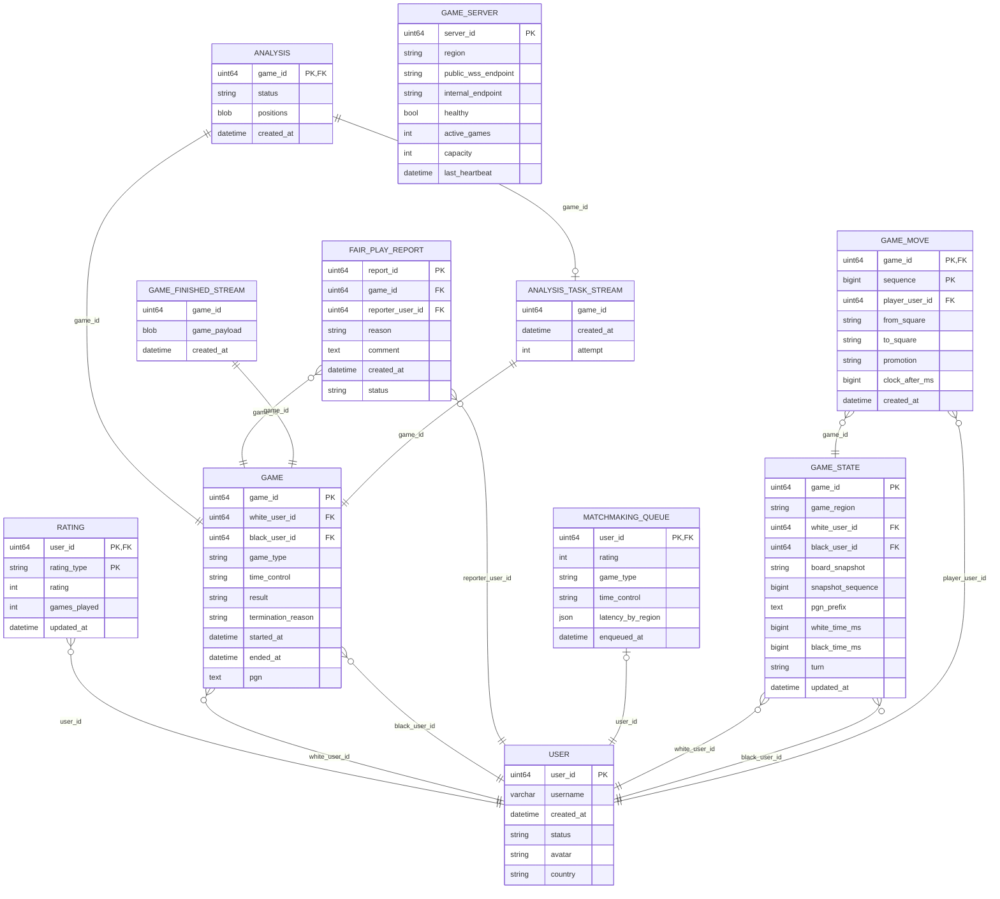
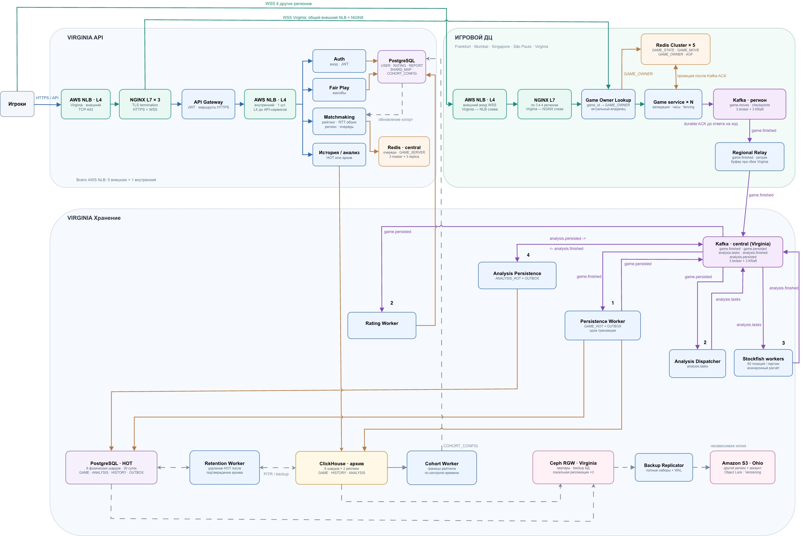

# Проектирование высоконагруженной платформы онлайн-шахмат

## 1. Тема и целевая аудитория

### 1.1. Тема

Проектируется сервис для игры в шахматы онлайн.

Основной аналог - **Chess.com**. Также к сервисам этого типа относится Lichess.

В работе рассматривается только основной игровой функционал. Обучение, боты, трансляции, клубы и другие дополнительные возможности Chess.com в проект не входят.

### 1.2. Целевая аудитория

Chess.com - глобальный сервис.

По отчёту Chess.com за II квартал 2026 года средняя дневная аудитория составляет **10,2 млн DAU**. На 30 июня 2026 года в сервисе было зарегистрировано более **267 млн пользователей** [[1]](#source1).

По данным официальной страницы Chess.com, месячная аудитория сервиса составляет более **50 млн пользователей в месяц** [[2]](#source2).

Аудитория распределена по всему миру. По данным Chess.com за июнь 2026 года, только на США и Индию приходится **84 млн зарегистрированных пользователей**, то есть примерно треть всей пользовательской базы. В России зарегистрировано 8,1 млн пользователей [[3]](#source3).

Для проектирования принимается глобальная аудитория Chess.com.

| Метрика | Значение |
| --- | ---: |
| MAU | 50+ млн |
| Средний DAU | 10,2 млн |
| Зарегистрированные пользователи | 267+ млн |
| География | Международная |

### 1.3. Функционал MVP

В MVP входят основные функции, необходимые для онлайн-игры:

1. Поиск соперника (матчмейкинг с учетом рейтинга пользователя).
2. Проведение партии - сервер принимает ходы, проверяет их и передаёт состояние партии сопернику.
3. Завершение партии (с пересчетом рейтинга и анализом партии).
4. Анализ партии - подсчет точности, подбор лучших ходов в каждой позиции (проводит серверная модель Stockfish).
5. Жалоба на нечестную игру.
6. Просмотр истории партий (с поиском по сопернику, виду партии, контролю времени).

### 1.4. Ключевые продуктовые решения

- Ходы передаются между игроками в реальном времени.
- Шахматные часы считаются на сервере, а не на клиенте.
- Одна завершённая партия хранится один раз и связывается с обоими игроками.
- Анализ сыгранной партии производится 1 раз и хранится.
- Матчмейкинг учитывает рейтинг игрока и выбранный контроль времени.

---

## 2. Расчёт нагрузки

Основные данные Chess.com за 2 квартал 2026 года [[1]](#source1):

- **10,2 млн DAU**;
- **2,8 млрд игр за квартал**;
- **380+ игр/с в пике**;
- **540+ млрд обработанных запросов за квартал**;
- **3,3 млн Fair Play reports за квартал**.

Chess.com не публикует долю игр отдельно от игр с ботами. Поэтому 2,8 млрд используется как верхняя оценка нагрузки.

### 2.1. Продуктовые метрики

#### Аудитория

| Метрика | Значение |
| --- | ---: |
| MAU | 50+ млн [[2]](#source2) |
| Средний DAU | 10,2 млн [[1]](#source1) |
| Зарегистрированные пользователи | 267+ млн [[1]](#source1) |

#### Игры и действия пользователя

Среднее количество партий в сутки (во 2 квартале 2026 года 91 день):

```text
2,8 млрд / 91 = 30,77 млн партий/сутки
```

В одной партии участвуют два игрока:

```text
30,77 млн × 2 / 10,2 млн DAU = 6,03 партии на активного пользователя в день
```

Для расчёта количества ходов принимается стандартная для Chess.com расчётная длина партии — **40 полных ходов**, то есть около **80 полуходов** [[5]](#source5).

```text
30,77 млн × 80 = 2,462 млрд ходов/сутки
```

На одного DAU:

```text
2,462 млрд / 10,2 млн = 241,3 хода/сутки
```

Fair Play:

```text
3,3 млн / 91 = 36,3 тыс. жалоб/сутки
```

```text
36,3 тыс. / 10,2 млн = 0,00356 жалобы на DAU в день
```

Анализ партии - продуктовое решение проекта: **каждая завершённая партия анализируется один раз**, результат сохраняется. Game Review на Chess.com также выполняется на сервере с использованием Stockfish [[6]](#source6).

| Действие | На одного DAU в день | Всего в сутки |
| --- | ---: | ---: |
| Участие в партии | 6,03 | 61,54 млн |
| Отправка хода | 241,3 | 2,462 млрд |
| Завершение партии | 3,02 | 30,77 млн |
| Анализ партии | — | 30,77 млн |
| Fair Play report | 0,00356 | 36,3 тыс. |

#### Просмотр истории и анализа

Chess.com не публикует частоту таких запросов.

Для проектируемого API принимается:

- после завершения партии каждый игрок один раз обновляет историю;
- после готовности анализа каждый игрок один раз получает его результат.

Получаем по две операции чтения на одну завершённую партию:

```text
30,77 млн × 2 = 61,54 млн запросов/сутки
```

для истории и столько же для получения анализа.

### 2.2. Средний объём хранения пользователя

Chess.com сообщает о базе из **30+ млрд партий** [[4]](#source4).

Размер внутренней записи Chess.com не опубликован. Для оценки используется открытый PGN-дамп Lichess. За июнь 2026 года в нём:

- **86 483 328 партий**;
- архив занимает **28,2 ГБ**;
- распакованный PGN примерно в **7,1 раза больше** [[7]](#source7).

Средний логический размер одной партии:

```text
28,2 ГБ × 7,1 / 86 483 328 ≈ 2,315 КБ
```

Объём 30 млрд партий:

```text
30 млрд × 2,315 КБ ≈ 69,45 ТБ
```

Среднее число партий в истории одного зарегистрированного пользователя:

```text
30 млрд × 2 / 267 млн ≈ 224,7 партии
```

Так как одна партия хранится один раз и связывается с двумя игроками, нормированный объём архива на аккаунт:

```text
69,45 ТБ / 267 млн ≈ 0,000260 ГБ ≈ 0,260 МБ
```

#### Результаты анализа

Размер результата анализа Chess.com не публикуется, поэтому используется формат проектируемого сервиса.

Для каждой позиции сохраняются:

- оценка позиции;
- класс сыгранного хода;
- лучший ход;
- линия Stockfish примерно на 12 полуходов.

При анализе примерно 80 позиций полезная нагрузка результата анализа принимается равной **≈2,5 КБ** на партию. Это проектный формат хранения, а не значение Chess.com.

```text
30 млрд × 2,5 КБ ≈ 75 ТБ
```

Итого для основных данных MVP:

| Тип данных | Количество | Логический объём |
| --- | ---: | ---: |
| Партии | 30+ млрд | ≈69,45 ТБ |
| Анализы партий | 30+ млрд | ≈75 ТБ |
| **Итого** | — | **≈144,45 ТБ** |

В среднем на зарегистрированный аккаунт:

```text
144,45 ТБ / 267 млн ≈ 0,000541 ГБ ≈ 0,541 МБ
```

Это **логический объём данных**. Репликация, индексы, резервные копии и служебные данные здесь не учитываются.

Прирост в сутки:

```text
Партии:
30,77 млн × 2,315 КБ ≈ 71,2 ГБ/сутки

Анализы:
30,77 млн × 2,5 КБ ≈ 76,9 ГБ/сутки

Итого ≈ 148,1 ГБ/сутки
```

### 2.3. API и RPS

Для среднего RPS:

```text
RPS = число операций в сутки / 86 400
```

Средняя скорость создания партий:

```text
30,77 млн / 86 400 = 356,1 партии/с
```

Chess.com публикует пик **380+ игр/с** [[1]](#source1).

Коэффициент пиковой нагрузки:

```text
Kpeak = 380 / 356,1 ≈ 1,067
```

#### Клиентское API и WebSocket

| Операция | Направление | Что делает | Операций в сутки | Средняя частота | Пик |
| --- | --- | --- | ---: | ---: | ---: |
| `POST /matchmaking/search` | клиент → сервер | Ставит игрока в очередь | 61,54 млн | 712 RPS | 760+ RPS |
| `WS game.move` | клиент → сервер | Передаёт ход | 2,462 млрд | 28 490 EPS | 30 400+ EPS |
| `WS game.end` | сервер → клиент | Передаёт результат и причину завершения: мат, сдача, время, ничья | 61,54 млн | 712 EPS | 760+ EPS |
| `WS game.resign` | клиент → сервер | Игрок сдаётся | ≤30,77 млн | ≤356 EPS | ≤380 EPS |
| `GET /games/history` | клиент → сервер | Возвращает историю с фильтрами | 61,54 млн* | 712 RPS | 760+ RPS |
| `GET /games/{id}/analysis` | клиент → сервер | Возвращает сохранённый анализ | 61,54 млн* | 712 RPS | 760+ RPS |
| `POST /fair-play/reports` | клиент → сервер | Создаёт жалобу | 36,3 тыс. | 0,42 RPS | — |

\* Для истории и анализа принято по одному запросу от каждого игрока после завершения партии.

`game.resign` имеет только верхнюю границу: в одной партии сдаться может не более одного игрока. Доля партий, завершённых сдачей, Chess.com не публикуется.

Мат определяется сервером после `game.move`. Отдельного клиентского запроса для мата нет. После любого завершения сервер отправляет обоим игрокам `game.end`.

Входящий поток без `game.resign`:

```text
712 + 28 490 + 712 + 712 + 0,42 ≈ 30 627 RPS
```

С учётом верхней границы `game.resign`:

```text
≤ 30 983 RPS
```

#### Внутренние операции

После завершения каждой партии сервер выполняет:

| Операция | Средняя частота | Пик |
| --- | ---: | ---: |
| `game.finished` (регион → Virginia) | 356/с | 380+/с |
| Запись `GAME_HOT` | 356 inserts/с | 380+/с |
| Запись двух `USER_GAME_HISTORY_HOT` | 712 inserts/с | 760+/с |
| `game.persisted` (после записи партии и истории) | 356 событий/с | 380+/с |
| Пересчёт рейтинга | 356 партий/с, по 2 игрока | 380+ партий/с |
| `analysis.tasks` и `analysis.finished` | по 356 событий/с | по 380+/с |
| `analysis.persisted` (результат записан) | 356 событий/с | 380+/с |

Региональный журнал должен выдерживать тот же поток, что и игровой сервис: около **28 490 полуходов/с** в среднем и **30 400+/с** в пике. Это внутренняя запись, а не дополнительный запрос клиента.

При 80 полуходах на партию Stockfish должен обработать:

```text
356,1 × 80 ≈ 28 490 позиций/с
```

В пике:

```text
380 × 80 = 30 400+ позиций/с
```

#### Проверка порядка величины

Chess.com сообщает о **540+ млрд обработанных запросов за Q2** [[1]](#source1):

```text
540 млрд / (91 × 86 400) ≈ 68 681+ запросов/с
```

Наш MVP даёт до **31 тыс. входящих запросов и WS-событий в секунду**. Остальной функционал Chess.com в расчёт не входит.

### 2.4. Сетевой трафик

Размеры сообщений задаются форматом проектируемого API.

| Операция | Размер |
| --- | ---: |
| Matchmaking request/response | ≈192 Б |
| Один ход | ≈208 Б |
| Завершение партии | ≈97 Б на игрока |
| Страница истории, 20 партий | ≈676 Б |
| Результат анализа партии | ≈2,66 КБ |
| Fair Play report | ≈353 Б |

**Matchmaking** содержит идентификатор пользователя, рейтинг и контроль времени. В ответ сервер возвращает `game_id`, данные соперника и цвет фигур.

**Ход** содержит `game_id`, номер хода, начальную и конечную клетки, превращение пешки и время игрока. Учитываются две передачи: игрок → сервер и сервер → соперник.

**Завершение партии** содержит `game_id`, результат, причину завершения и изменение рейтинга. Сообщение отправляется обоим игрокам.

**История партий** возвращает до 20 записей: идентификатор партии, соперника, дату, результат, рейтинг и контроль времени.

**Анализ партии** содержит данные примерно для 80 позиций. Для каждой позиции сохраняются оценка, класс хода, лучший ход и линия Stockfish примерно на 12 полуходов. Полезная нагрузка анализа составляет около **2,5 КБ**. С учётом сетевых заголовков — около **2,66 КБ**.

**Fair Play report** содержит `game_id`, пользователя, причину жалобы и текстовый комментарий.

В размер сетевого сообщения включаются заголовки Ethernet, IPv4, TCP, TLS и WebSocket. Для HTTP-запросов размер заголовков зависит от реализации, поэтому расчёт остаётся приблизительным.

#### Суточный и пиковый трафик

| Тип трафика | За сутки | Пиковая полоса |
| --- | ---: | ---: |
| Matchmaking | ≈11,8 ГБ | ≈0,0012 Гбит/с |
| Ходы | ≈512 ГБ | ≈0,0506 Гбит/с |
| Завершение партии | ≈6,0 ГБ | ≈0,0006 Гбит/с |
| История партий | ≈41,6 ГБ | ≈0,0041 Гбит/с |
| Анализ партии | ≈163,7 ГБ | ≈0,0162 Гбит/с |
| Fair Play | ≈0,01 ГБ | <0,0001 Гбит/с |
| **Итого** | **≈735,1 ГБ/сутки** | **≈0,0727 Гбит/с** |

Основной внешний трафик создают ходы и передача результатов анализа. В таблицу не включены межзонная репликация БД/Kafka и передача резервных копий в облако — они учитываются отдельно при расчёте оборудования.

Для регионального журнала при 128–256 Б на событие и трёх копиях ориентировочный суточный объём записи составляет `2,462 млрд × 128–256 Б × 3 ≈ 0,95–1,89 ТБ` для всей платформы без контрольных точек и накладных расходов Kafka.

---

## 3. Глобальная балансировка нагрузки

### 3.1. Функциональное разбиение по доменам

| Домен | Назначение |
| --- | --- |
| `api.chess.example` | матчмейкинг, история партий, анализ, Fair Play |
| `gs-{server_id}.game-{region}.chess.example` | персональный WSS-адрес Game service, возвращаемый Matchmaking |

Матчмейкинг специально вынесен из игрового сервиса для создания легковесных игровых обработчиков.

### 3.2. Расположение ДЦ

Для международной аудитории выбраны пять игровых регионов [[3]](#source3):

| Регион | География |
| --- | --- |
| Virginia | Северная Америка |
| Frankfurt | Европа |
| Mumbai | Индия |
| Singapore | Юго-Восточная Азия |
| São Paulo | Южная Америка |

**Каждый регион содержит три зоны доступности (AZ-A, AZ-B, AZ-C)** с независимыми питанием и сетевой инфраструктурой. Между AZ поддерживается низкая задержка, позволяющая размещать реплики хранилищ в разных зонах. Точное расстояние между площадками определяется AWS; всего в проекте 15 AZ.

Во всех пяти регионах, включая Virginia, работают игровые сервисы, Redis и региональная Kafka. Дополнительно в Virginia размещены основной API, PostgreSQL, архив и центральная Kafka. Сервисы и реплики распределены между AZ. Kubernetes использует `topologySpreadConstraints` и `podAntiAffinity` [[21]](#source21). При потере одной AZ оставшиеся две должны сохранить кворум и обслуживание в пределах региона.

### 3.3. Глобальная балансировка

```text
api.chess.example → Virginia → API
```

Все запросы авторизации, поиска соперника, истории и жалоб идут в Virginia. Matchmaking подбирает не только игровой **регион**, но и конкретный **Game service**, который владеет партицией Kafka, соответствующей `game_id`. Только после подтверждения готовности этого сервера оба игрока получают `game_id`, адрес `wss://gs-{server_id}.game-{region}.chess.example/ws` и краткоживущий игровой токен. Ходы идут **напрямую** на назначенный Game service; через Virginia проходят только запросы центрального API.

**На пути WebSocket-соединений нет ни AWS NLB, ни NGINX.** Каждый из 30 игровых серверов имеет доступный клиентам защищённый WSS-адрес и самостоятельно завершает TLS. Балансировка игровых партий выполняется логикой Matchmaking при назначении новых матчей, а не сетевым прокси при подключении. Для **центрального API в Virginia сохраняется один внешний AWS NLB (L4)**: Route 53 направляет домен API на NLB, NLB распределяет TCP-соединения между тремя NGINX, а API Gateway выбирает экземпляры Auth, Matchmaking, Fair Play и History/Analysis **без отдельного внутреннего L4**. Детали — в разделе 4. [[27]](#source27), [[39]](#source39), [[44]](#source44).

Полный отказ Virginia ограничивает новые матчи и основной API, но уже начатые партии в остальных регионах могут продолжаться.

### 3.4. Распределение нагрузки

Из раздела 2:

| Операция | Средняя нагрузка | Пиковая нагрузка |
| --- | ---: | ---: |
| Matchmaking | 712 RPS | 760+ RPS |
| Ходы | 28 490 EPS | 30 400+ EPS |
| Завершение партии | 712 EPS | 760+ EPS |
| Сигнал досрочной сдачи | ≤356 EPS | ≤380 EPS |
| История партий | 712 RPS | 760+ RPS |
| Получение анализа | 712 RPS | 760+ RPS |
| Fair Play | 0,42 RPS | - |

Нагрузка на `api.chess.example` составляет около **2,14 тыс. RPS** в среднем без учёта игровых событий. Основная нагрузка на игровые регионы - **28,49 тыс. ходов/с** в среднем.

Chess.com не публикует DAU по регионам, поэтому точное распределение RPS между ДЦ не рассчитывается.

Все API-запросы направляются в Virginia. Игровая нагрузка распределяется Matchmaking по регионам и доступным владельцам игровых партиций. Новые партии можно распределять между несколькими Game service без внешних игровых балансировщиков.

### 3.5. Размещение данных

Постоянные данные пользователей, рейтингов и HOT-партий хранятся в Virginia. Каждый игровой регион независимо хранит рабочее состояние в Redis и фиксирует подтверждённые ходы в **региональной Kafka**.

```text
Game service → региональная Kafka (game.moves / game.checkpoints / game.finished)
             → MirrorMaker 2 (регион → Virginia)
             → Kafka Virginia ({region}.game.finished)
             → Game Persistence Worker → PostgreSQL HOT: GAME_HOT + 2 HISTORY_HOT
             → центральная Kafka (game.persisted)
                 ├─ Rating Worker → основной PostgreSQL (RATING)
                 ├─ Analysis Dispatcher → analysis.tasks → Stockfish
                 └─ Game Persistence Worker (архивный consumer) → ClickHouse
             → analysis.finished → Analysis Persistence Worker
             → PostgreSQL ANALYSIS_HOT → analysis.persisted
             → Analysis Persistence Worker (архивный consumer) → ClickHouse
```

**Kafka MirrorMaker 2** реплицирует только региональный topic `game.finished` в центральную Kafka, сохраняя исходный кластер в имени целевого topic (например, `frankfurt.game.finished`). В отличие от самописного Relay, это готовый механизм Kafka Connect. При временной недоступности Virginia события остаются в региональном topic; после восстановления репликация продолжится, пока записи доступны в пределах retention. Доставка может повторяться, поэтому используется идемпотентность по `game_id`. [[40]](#source40).

В Virginia обрабатывается около **356 завершённых партий/с** в среднем и **380+/с** в пике. При `≈2,5 КБ` на событие входящий поток составляет `≈0,89–0,95 МБ/с` без репликации. После фиксации партии и двух записей истории `Game Persistence Worker` публикует `game.persisted`. Все обработчики допускают повторную доставку и используют устойчивые идентификаторы событий и `game_id` для исключения повторного бизнес-эффекта. Архивирование в ClickHouse выполняется асинхронно, поэтому его задержка не блокирует рейтинг и запуск анализа.

### 3.6. Anycast

Anycast не используется. Домен `api.chess.example` через Route 53 указывает на **внешний AWS NLB в Virginia** (DNS Alias). NLB принимает TCP:443, проверяет работоспособность NGINX и распределяет соединения между тремя экземплярами NGINX. Выбор конкретного внутреннего API-сервиса остаётся за API Gateway. Конкретный игровой регион и адрес Game service выбирает Matchmaking; при смене владельца клиент получает новый адрес через API повторного подключения.

---

## 4. Подключение игроков и распределение нагрузки

### 4.1. Внешняя L4-балансировка и внутренняя маршрутизация API

Для центрального API в Virginia используется следующая цепочка:

```text
Клиент → Route 53 (DNS) → AWS NLB (внешний L4, TCP:443)
                                   ↓
                              NGINX L7 × 3
                                   ↓
                              API Gateway
                                   ↓
                      Auth / Matchmaking / Fair Play /
                              History API
```

**Внешний балансировщик сохраняется.** Один публичный **AWS Network Load Balancer (L4)** принимает новые TCP-соединения на порту 443 и распределяет их между тремя активными NGINX в разных AZ Virginia. NLB выполняет проверки доступности и исключает недоступные NGINX из target group. TLS завершается на NGINX; NLB использует TCP passthrough. Route 53 обеспечивает только разрешение имени `api.chess.example` через Alias-запись на NLB, а не балансирует запросы между NGINX [[27]](#source27), [[29]](#source29), [[39]](#source39).

**Внутреннюю балансировку выполняет API Gateway.** После получения HTTPS-запроса Gateway выбирает здоровый экземпляр требуемого микросервиса (Auth, Matchmaking, Fair Play, History/Analysis). Готовый вариант реализации — Envoy с обнаружением backend-адресов и алгоритмом `least_request`.

Шесть экземпляров API Gateway работают на уже предусмотренных серверах приложений; NGINX — на трёх выделенных виртуальных машинах с внутренними IP, доступными NLB. Для одного внешнего NLB при трёх AZ предусмотрены три публичных IPv4, по одному на зону, а для NGINX — TLS-сертификаты.

### 4.2. Прямое игровое подключение

После успешного матчмейкинга клиенты подключаются непосредственно к **одному Game service**, назначенному партии. На пути игрового WSS нет NLB и NGINX. Game service принимает WSS, проверяет игровой токен, валидирует и фиксирует ходы в региональной Kafka. У каждого Game service есть стабильное публичное DNS-имя; адрес зарегистрирован в `GAME_SERVER`.

```text
Игрок → api.chess.example → Route 53 → AWS NLB → NGINX → API Gateway → Matchmaking
                                                               ↓
                       game_id + wss_url + game_token ← выбранный Game service

Игрок A ── WSS ──┐
                 ├──→ Game service → Kafka game.moves
Игрок B ── WSS ──┘                ↘ Redis GAME_STATE
```

Оба игрока получают одинаковый серверный адрес. Игровой токен проверяется по `game_id`, `user_id`, роли игрока и времени действия; токен не передаётся в URL и не записывается в журналы.

### 4.3. Как выбирается Game service и что происходит при отказе

Matchmaking выбирает регион по RTT и текущей загрузке, затем создаёт `game_id`, вычисляет партицию Kafka `game.moves` и читает `GAME_OWNER[partition_id]` в региональном Redis. В реестре `GAME_SERVER` находится доступный публичный адрес этого владельца и информация о загрузке. Если сервер перегружен, можно выбрать другую доступную партицию или регион. Назначение подтверждается сервером до выдачи ответа игрокам.

После отказа Game service соединения WSS разрываются. Kafka назначает нового владельца соответствующей партиции. **Прежде чем принимать ходы, новый Game service восстанавливает состояние партии из Kafka** (см. п. 5.3): читает последнюю подходящую контрольную точку `game.checkpoints`, затем воспроизводит подтверждённые `game.moves` с большим `sequence`, проверяет `owner_epoch` и актуализирует Redis. Старый владелец блокируется fencing. Только после восстановления обновляется `GAME_OWNER` и разрешается подтверждение новых ходов.

Клиент повторно обращается к `GET /games/{game_id}/connection` центрального API, получает новый `wss_url` и подключается напрямую. API не проксирует игровые ходы. Если Virginia полностью недоступна, установленная игра в другом регионе продолжится, однако получение нового WSS-адреса при одновременном отказе Game service может быть невозможно — это принятое ограничение учебного проекта.

TLS для игрового WSS завершается непосредственно на Game service. Все публичные узлы нуждаются в защите от перегрузки, TLS-сертификатах, контроле одновременно открытых соединений и ограничении повторных запросов. Оценки новых TLS-сеансов и WSS не приравниваются к RPS.

---

# 5. Логическая схема базы данных

В разделе описываются логические сущности и потоки данных без привязки к конкретной СУБД, схеме шардинга и физическому размещению.

## 5.1. Идентификаторы

Автоинкрементные идентификаторы не используются для сущностей, которые потенциально создаются на разных узлах.

Независимые шарды могут генерировать пересекающиеся последовательности, а единый центральный sequence создаёт дополнительную точку синхронизации.

Для `user_id`, `game_id`, `report_id` и `server_id` используется 64-битный распределённый идентификатор:

```text
timestamp | worker_id | sequence
```

Размер идентификатора — `8 Б`.

Он генерируется без обращения к центральной БД, уникален между узлами, приблизительно сортируется по времени создания и занимает в два раза меньше места, чем бинарный UUID (`16 Б`).

## 5.2. Логическая схема



`GAME_SERVER` не связан внешним ключом с партией: это реестр доступности, загрузки и публичных WSS-адресов. Matchmaking использует `GAME_OWNER` в региональном Redis, чтобы выбрать сервер-владелец партиции для `game_id`; клиент подключается к нему без NGINX и игрового NLB (п. 7.5).

## 5.3. Хранение ходов и состояния активной партии

Игровой сервер проверяет ход, его порядковый номер и актуальность владельца партии. **Прежде чем подтвердить ход игрокам, он фиксирует событие в региональной Kafka** (`game.moves`). Это долговечный журнал, размещённый в трёх AZ. Redis содержит быстрое рабочее представление того же состояния.

```text
WS game.move → Game service → Kafka game.moves (подтверждение)
                               ↓
                         Redis GAME_MOVE / GAME_STATE
                               ↓
                         ответ двум игрокам
```

Событие содержит `game_id`, номер полухода, ход, состояние часов и версию владельца. Повтор той же команды не создаёт второй ход. События одной партии направляются в одну партицию Kafka по `game_id`, поэтому их порядок сохраняется.

`GAME_STATE` хранит snapshot позиции и `snapshot_sequence`, а `GAME_MOVE` — не включённый в snapshot хвост. Каждые **10 полуходов** Redis атомарно обновляет snapshot и удаляет уже применённый хвост. После сбоя состояние можно восстановить из snapshot и недостающих событий Kafka; Redis не является единственным источником истины. Для длительного восстановления периодические контрольные точки записываются также в отдельный компактируемый topic `game.checkpoints`.

**Явный алгоритм восстановления Game service:** (1) получить право владения Kafka-партицией и заблокировать прежнего владельца через fencing; (2) найти в `game.checkpoints` последнюю подтверждённую контрольную точку нужного `game_id` с её `sequence`/Kafka offset; (3) прочитать из `game.moves` все более поздние подтверждённые ходы этой партии в порядке их `sequence` (для транзакционных записей — `read_committed`); (4) восстановить позицию, часы, очередность хода и последнее принятое событие; (5) сверить/обновить проекцию в Redis `GAME_STATE` и запись `GAME_OWNER`; (6) только после этого разрешить переподключение и подтверждение новых ходов. Для работоспособности необходимы корректная привязка checkpoint к offset и retention журнала, достаточный для воспроизведения хвоста. После истечения retention без подходящей контрольной точки восстановление уже не гарантируется.

**Переключение Game service.** За каждой партицией журнала закреплён один действующий игровой обработчик. Назначение определяется через Kafka consumer group; для записи используется транзакционный producer со стабильным `transactional.id` на партицию. При смене владельца новый producer блокирует предыдущий механизмом fencing. До завершения восстановления последовательности ходов партия не принимает новые подтверждаемые действия. Номера полуходов и идентификаторы команд позволяют распознать повторную доставку. Ответ игрокам отправляется только после успешной фиксации события; корректность протокола проверяется тестами с остановкой процесса и сетевым разделением [[20]](#source20), [[26]](#source26).

**Завершение партии.** Game service фиксирует `game.finished` в **отдельном topic региональной Kafka**. Если результат получен последним ходом, запись этого хода в `game.moves` и запись `game.finished` выполняются в одной Kafka-транзакции; в иных случаях публикуется терминальное событие с версией партии. Оно содержит результат и PGN либо сведения для восстановления. MirrorMaker 2 читает только подтверждённые события (`read_committed`) и реплицирует `game.finished` в центральную Kafka Virginia под именем `{region}.game.finished`. Повторы безопасны за счёт идемпотентности по `game_id`. Временное состояние Redis удаляется после подтверждённой центральной обработки. Retention регионального topic должен превышать максимальную длительность недоступности центра и допустимое отставание репликации; при превышении потребуется отдельное восстановление из архивных копий.

## 5.4. Реестр игровых серверов

`GAME_SERVER` содержит текущее состояние игровых узлов:

| Поле | Назначение |
| --- | --- |
| `server_id` | глобальный идентификатор узла |
| `region` | игровой регион |
| `public_wss_endpoint` | публичный адрес для прямого WSS-подключения игроков |
| `internal_endpoint` | адрес служебного взаимодействия внутри региона |
| `healthy` | допускается ли узел к новым подключениям |
| `active_games` | число активных партий |
| `capacity` | расчётная вместимость |
| `last_heartbeat` | время последнего heartbeat |

Matchmaking выбирает регион и конкретный сервер: вычисляет партицию по `game_id`, получает текущий `server_id` из `GAME_OWNER[partition_id]` в региональном Redis и находит его публичный адрес в `GAME_SERVER`. Серверу направляется проверка готовности к новой партии; только после неё адрес выдаётся обоим игрокам. Отдельный Game Owner Lookup и игровые прокси **не используются**. При смене владельца запись `GAME_OWNER` обновляется, а клиент может повторно запросить адрес через API. Право подтверждать ход проверяется Kafka fencing, а не только наличием записи в Redis.

Если heartbeat не поступает дольше заданного timeout, сервер считается `unhealthy`.

## 5.5. Описание сущностей

| Сущность | Назначение |
| --- | --- |
| `USER` | Учётная запись пользователя |
| `RATING` | Рейтинг пользователя по типам партий |
| `GAME` | Постоянная запись завершённой партии и PGN |
| `ANALYSIS` | Сохранённый результат Stockfish |
| `FAIR_PLAY_REPORT` | Жалоба на конкретную партию |
| `MATCHMAKING_QUEUE` | Игроки, ожидающие соперника |
| `GAME_STATE` | Последний подтверждённый snapshot активной партии |
| `GAME_MOVE` | Хвост ходов после последнего snapshot |
| `GAME_SERVER` | Реестр игровых узлов, их health и загрузки |
| `GAME_FINISHED_STREAM` | Kafka-поток завершённых партий |
| `ANALYSIS_TASK_STREAM` | Kafka-поток задач Stockfish |

## 5.6. Размеры данных и нагрузка

Для snapshot принимается `K = 10`.

| Сущность | Количество и размер | Чтение | Запись |
| --- | --- | ---: | ---: |
| `USER` | 267+ млн строк; `≈96 Б/строка` без файла аватара | не менее `≈712 QPS` для matchmaking | регистрация не входит в рассчитанный MVP |
| `RATING` | `267 млн × K_rating`; `≈32 Б/строка` | `≈712 QPS` | `≈712 updates/с`, пик `≈760/с` |
| `GAME` | 30+ млрд; `≈2,315 КБ/партия`; `≈69,45 ТБ` | history `≈712 QPS` | `≈356 inserts/с`, пик `≈380/с` |
| `USER_GAME_HISTORY_HOT` (производная запись) | 2 строки на партию в пределах HOT 30 суток; отдельно от единственного экземпляра `GAME` | `≈712 QPS` для истории | `≈712 inserts/с`, пик `≈760/с`; создаёт Game Persistence Worker |
| `ANALYSIS` | до 30+ млрд; `≈2,5 КБ/строка`; `≈75 ТБ` | `≈712 QPS` | `≈356 results/с`, пик `≈380/с` |
| `FAIR_PLAY_REPORT` | `36,3 тыс./сутки`; `≈512 Б/строка` | клиентское чтение не входит в MVP | `≈0,42 inserts/с` |
| `MATCHMAKING_QUEUE` | `≈712 × W` активных записей | зависит от алгоритма | `≈712 enqueue/с + 712 dequeue/с` |
| `GAME_MOVE` | не более `K-1` неслитых строк на активную партию; `≈64 Б/строка` | при реконструкции до `K-1` строк; при компактизации `≈28 490 row reads/с`, пик `≈30 400/с` | `≈28 490 inserts/с`, пик `≈30 400+/с`; batch-delete `≈2 849 ops/с`, пик `≈3 040/с` |
| `GAME_STATE` | одна запись на активную партию; несколько КБ с `pgn_prefix` | чтение при реконструкции, reconnect, failover и компактизации | при `K=10`: `≈2 849 updates/с`, пик `≈3 040/с` |
| `GAME_SERVER` | число игровых серверов | читается matchmaking/control-plane | `S/H` heartbeat updates/с |
| `GAME_FINISHED_STREAM` | `≈2,5 КБ/event` | `≈356 msg/с` | `≈356 msg/с`, пик `≈380/с` |
| `ANALYSIS_TASK_STREAM` | `≈64 Б/event` | `≈356 msg/с` | `≈356 msg/с`, пик `≈380/с` |

Где:

```text
K = 10 — число ходов между snapshot;
K_rating — число рейтинговых категорий;
W — среднее время ожидания matchmaking;
S — количество игровых серверов;
H — интервал heartbeat в секундах.
```


---

# 6. Физическая схема базы данных

В проекте используются два класса постоянного хранения:

- **OLTP-хранилище** — для данных, к которым нужен быстрый доступ и частые точечные чтения/изменения;
- **OLAP-хранилище** — для большого архива завершённых партий и исторических запросов.

Такое разделение позволяет не держать все `30+ млрд` партий в дорогом быстром OLTP-хранилище.

Для проектируемой системы принимается следующая политика:

```text
последние 30 суток -> PostgreSQL
вся история        -> ClickHouse
```

ClickHouse получает завершённые партии асинхронно после появления `game.persisted`: архивный обработчик внутри **того же Deployment Game Persistence Worker** независимо читает это событие и пакетно записывает `GAME_ARCHIVE` и две записи `USER_GAME_HISTORY_ARCHIVE`. Результаты Stockfish аналогично архивируются обработчиком внутри **Analysis Persistence Worker** после `analysis.persisted`. Отдельных сервисов архивирования нет. При недоступности ClickHouse архивные consumer offsets не подтверждаются, а исходные HOT-данные удерживаются до сверки; месяц спустя не требуется отдельная тяжёлая миграция всей истории.

После истечения 30 суток данные удаляются из PostgreSQL только после проверки полноты архива в ClickHouse (п. 6.2).

Если у пользователя за последние 30 суток меньше 20 партий, API получает недостающие строки истории из ClickHouse. Таким образом, интерфейс всегда может показать последние 20 партий, но полная запись старой партии не обязана находиться в PostgreSQL.

---

## 6.1. Выбор систем хранения

| Данные | Система хранения | Обоснование |
| --- | --- | --- |
| `USER`, `RATING`, `FAIR_PLAY_REPORT` | PostgreSQL | транзакционные данные, точечные чтения и изменения |
| `GAME` за последние 30 суток | шардированный PostgreSQL | быстрый доступ к недавно сыгранным партиям |
| `ANALYSIS` за последние 30 суток | тот же шардированный PostgreSQL | анализ часто запрашивается сразу после завершения партии |
| история пользователя за последние 30 суток | PostgreSQL | первая страница истории должна возвращаться с минимальной задержкой |
| полный архив `GAME` | ClickHouse | большой объём, преимущественно чтение и фильтрация |
| полный архив `ANALYSIS` | ClickHouse | исторические данные почти не изменяются |
| полная история пользователя | ClickHouse | удобна для фильтрации по периоду, сопернику и типу партии |
| `MATCHMAKING_QUEUE` | Redis Cluster | короткоживущие данные и низкая задержка |
| `GAME_STATE`, `GAME_MOVE` | региональный Redis Cluster | горячее состояние активных партий |
| `GAME_SERVER`, `GAME_OWNER` | Redis Cluster | heartbeat серверов и маршруты игровых партиций |
| `game.moves`, `game.checkpoints`, `game.finished` | региональная Kafka | журнал ходов, контрольные точки и подтверждённое завершение партии |
| `{region}.game.finished` (5 региональных topics), `game.persisted`, `analysis.tasks`, `analysis.finished`, `analysis.persisted` | Kafka Virginia | приём завершений через MirrorMaker 2 и независимая обработка результатов |
| аватары | Ceph RGW | основное S3-совместимое объектное хранилище |
| резервные копии PostgreSQL и ClickHouse | Ceph RGW + облачный Amazon S3 | локальное восстановление и независимая защищённая копия вне Virginia |
| статистика активных игроков для расчёта когорт | ClickHouse | периодическая агрегация распределения рейтингов |
| когорты для матчмейкинга | основной PostgreSQL | компактная конфигурация для рабочего контура matchmaking |

PostgreSQL используется как реляционная OLTP-СУБД, Redis - как in-memory хранилище, ClickHouse - как аналитическая колоночная СУБД, Kafka - как потоковая система.

---

## 6.2. Горячее и архивное хранение партий

Средний прирост основных данных:

```text
GAME     ≈ 71,2 ГБ/сутки
ANALYSIS ≈ 76,9 ГБ/сутки

Итого    ≈ 148,1 ГБ/сутки
```

За 30 суток:

```text
148,1 × 30 ≈ 4,44 ТБ
```

Следовательно, в PostgreSQL не требуется хранить весь архив объёмом `≈144,45 ТБ`.

В нём находится только горячий набор данных порядка:

```text
≈4,44 ТБ данных GAME_HOT и ANALYSIS_HOT
+ USER_GAME_HISTORY_HOT, индексы, WAL и служебные данные
```

`GAME_HOT`, `ANALYSIS_HOT` и `USER_GAME_HISTORY_HOT` на каждом физическом шарде секционируются по `ended_at` на **дневные разделы (UTC)**. Разделы создаются заранее; `DEFAULT`-раздел не используется. Такой способ позволяет удалять старые данные без массового `DELETE` и последующего `VACUUM` [[13]](#source13).

**Удаление старых данных** выполняет `Retention Worker` (Kubernetes CronJob) один раз в сутки:

1. Выбирает завершённые дневные разделы старше 30 суток и закрывает их для новых HOT-записей; запоздавшие результаты направляются в ClickHouse.
2. Дожидается завершения записи и сверяет число и контрольные суммы партий, истории и готовых анализов с ClickHouse. Проверяет, что события дня обработаны и нет незавершённых архивных задач; статус фиксируется в основном PostgreSQL (`ARCHIVE_PARTITION_STATUS`: таблица, шард, день, число записей, контрольная сумма, статус).
3. Отсоединяет подтверждённый раздел через `DETACH PARTITION ... CONCURRENTLY`, затем удаляет отсоединённую таблицу [[13]](#source13), [[14]](#source14).

Операция выполняется для всех трёх HOT-таблиц и восьми шардов (до **24 дневных разделов в сутки**). В штатном режиме освобождается около `148,1 ГБ/сутки` логических данных `GAME_HOT + ANALYSIS_HOT` без истории, индексов и реплик. При отсутствии подтверждения архива, расхождении данных или задержке обработчиков раздел **не удаляется**: срок горячего хранения временно увеличивается. Повторное выполнение задачи безопасно; параллельная очистка одного раздела запрещена.

---

## 6.3. Шардирование PostgreSQL

Для горячего хранилища принимается `8` групп PostgreSQL.

При равномерном распределении:

```text
4,44 ТБ / 8 ≈ 0,56 ТБ логических данных на шард
```

Это оценка только `GAME_HOT + ANALYSIS_HOT`, без истории, индексов и WAL. Даже с индексами и запасом это значительно проще размещать на сервере, чем весь архив.

Каждая группа содержит **1 основной узел и 2 реплики в разных AZ**. CloudNativePG управляет переключением; транзакция подтверждается после получения WAL как минимум одной синхронной репликой [[15]](#source15), [[16]](#source16).

```text
HOT PostgreSQL:  8 × 3 = 24 экземпляра
Основной PostgreSQL:      3 экземпляра
Итого:                   27 экземпляров
```

Для трёх копий основных горячих данных требуется приблизительно `4,44 × 3 = 13,32 ТБ` дискового пространства без индексов, истории, WAL и запаса. Число физических серверов определяется отдельно.

### Виртуальные сегменты

Прямое правило вида `shard = game_id % 8` не используется: при изменении количества физических шардов оно потребовало бы массового перераспределения данных.

Вместо этого применяется `1024` виртуальных сегмента:

```text
bucket_id = hash64(game_id) mod 1024
SHARD_MAP[bucket_id] -> physical_shard
```

При 8 шардах приходится по `128` виртуальных сегментов на шард. `SHARD_MAP` хранится в основном PostgreSQL и кешируется маршрутизатором.

`GAME_HOT` и `ANALYSIS_HOT` размещаются по `game_id` на одном шарде. `USER_GAME_HISTORY_HOT` распределяется независимо, по `hash64(user_id) mod 1024`, чтобы история пользователя не требовала обхода всех шардов. Для двух семейств используются отдельные отображения виртуальных сегментов на те же восемь групп PostgreSQL.

---

## 6.4. Таблицы PostgreSQL

### USER

```text
PK (user_id)
UNIQUE (username)
INDEX (country)
```

`avatar` содержит только ключ объекта в Ceph RGW.

### RATING

```text
PK (user_id, rating_type)
```

Оба рейтинга одной партии обновляются одной транзакцией. `RATING_APPLIED_GAME (game_id PK)` фиксирует применённые результаты, исключая повторный пересчёт при повторной доставке события.

### FAIR_PLAY_REPORT

```text
PK (report_id)
INDEX (game_id)
INDEX (reporter_user_id, created_at DESC)
INDEX (status, created_at)
```

### GAME_HOT

```text
PK (game_id, ended_at)
INDEX (ended_at)
```

Таблица секционируется по `ended_at` на дневные разделы (UTC). В состав физического первичного ключа включается ключ секционирования — требование PostgreSQL [[13]](#source13).

### ANALYSIS_HOT

```text
PK (game_id, ended_at)
```

Хранится на том же шарде, что и `GAME_HOT`. Для секционирования используется `ended_at` исходной партии, а не время готовности анализа. Запоздавший анализ старой партии сохраняется непосредственно в ClickHouse.

### USER_GAME_HISTORY_HOT

```text
PK (user_id, ended_at, game_id)
INDEX (user_id, ended_at DESC)
INDEX (user_id, opponent_user_id, ended_at DESC)
INDEX (user_id, game_type, time_control, ended_at DESC)
```

Секционируется по `ended_at` на дневные разделы. На одну партию создаются две записи: для белых и для чёрных.

```text
356 партий/с × 2 ≈ 712 inserts/с
```

Уникальность `game_id` между разными дневными разделами обеспечивается идемпотентностью обработчика записи; составной физический PK сам по себе не обеспечивает глобальную уникальность одного `game_id`.

### Согласованная запись партии и пользовательской истории

**Game Persistence Worker** обрабатывает `game.finished` и сохраняет завершённую партию в `GAME_HOT`, а также две строки `USER_GAME_HISTORY_HOT` (для белого и чёрного игроков). `GAME_HOT` распределена по `game_id`, история — по `user_id`; **три записи могут оказаться в разных физических PostgreSQL-шардах и не образуют одной ACID-транзакции**. На каждом шарде запись выполняется локальной транзакцией с проверкой уникального бизнес-ключа. Повторная обработка безопасно пропускает сохранённое и восстанавливает недостающие строки.

Для записей истории физический ключ `(user_id, ended_at, game_id)` обеспечивает уникальность в пределах секционирования. В событии `game.finished` фиксируются неизменные `game_id`, `ended_at` (UTC), `white_user_id`, `black_user_id` и итог партии; повтор должен использовать те же значения. `GAME_HOT` и история сохраняются идемпотентно, а изменение несовпадающего результата для уже сохранённого `game_id` рассматривается как конфликт и требует разбора, а не безусловной перезаписи.

**Подтверждение обработки Kafka.** Worker публикует `game.persisted` лишь после успешной записи `GAME_HOT` и двух записей истории. Он ждёт успешного ответа producer с `acks=all` и только затем фиксирует входной offset `game.finished`. Сбой между публикацией и commit offset может привести к повторному `game.persisted`, но не к повторной записи бизнес-данных. Единой атомарной транзакции «несколько PostgreSQL-шардов + Kafka» в этой модели нет. При длительных сбоях требуются повторные попытки с backoff, контроль consumer lag, мониторинг несогласованных записей и срок хранения исходных событий, достаточный для восстановления.

Событие `game.persisted` означает, что **партия и история двух игроков доступны в HOT**, но не утверждает, что рейтинг уже пересчитан, архив записан или анализ готов.

---

## 6.5. Архив в ClickHouse

ClickHouse используется для хранения данных, которые после завершения партии практически не изменяются.

Используются три основные таблицы.

### GAME_ARCHIVE

Организация:

```text
PARTITION BY toYYYYMM(ended_at)
ORDER BY game_id
```

### ANALYSIS_ARCHIVE

Основной поиск выполняется по `game_id`.

### USER_GAME_HISTORY_ARCHIVE

Организация данных:

```text
PARTITION BY toYYYYMM(ended_at)
ORDER BY (user_id, ended_at, game_id)
```

Такой порядок подходит под запрос:

```text
история пользователя
+ период
+ соперник
+ тип партии
```

ClickHouse хорошо подходит для этой части системы, потому что архив:

- очень большой;
- в основном дописывается;
- почти не изменяется;
- читается по большим историческим диапазонам;
- используется для фильтрации и аналитики.

Архивирование выполняют **архивные потребители внутри Game Persistence Worker и Analysis Persistence Worker**, а не отдельные Workers. Первый потребляет `game.persisted` и записывает партию вместе с двумя пользовательскими проекциями истории; второй потребляет `analysis.persisted` и записывает `ANALYSIS_ARCHIVE`. У этих обработчиков **отдельные consumer groups**, не общие с группами, выполняющими HOT-запись; подтверждение offset допускается только после проверки записи в ClickHouse. Повторы подавляются по бизнес-ключам и версии результата, при необходимости с дедупликацией и периодической сверкой. Результаты, поступившие позже срока HOT, записываются сразу в архив по той же логике.

---

## 6.6. GAME_SERVER и matchmaking

Реестр игровых серверов хранится в Redis: `gameserver:{server_id}`

Поля:

```text
region
public_wss_endpoint
internal_endpoint
healthy
active_games
capacity
last_heartbeat
```

Heartbeat обновляет запись и срок жизни. Если heartbeat перестал приходить, запись истекает, и сервер перестаёт считаться доступным.

Matchmaking использует этот реестр для оценки загрузки регионов и выбора актуального Game service. Для `game_id` определяется партиция `game.moves`, её владелец находится в региональном `GAME_OWNER`, после чего возвращается `public_wss_endpoint` из `GAME_SERVER`. При повторном подключении этот же выбор выполняется через API, без NGINX в игровом регионе; устаревший адрес не даёт права на запись.

Когорты рассчитываются отдельно для каждого сочетания:

```text
game_type + time_control
```

Общий поток данных:

```text
USER_GAME_HISTORY_ARCHIVE
        ↓
ClickHouse
        ↓
агрегация активных игроков и рейтингов
        ↓
расчёт границ когорт
        ↓
MATCHMAKING_COHORT_CONFIG
        ↓
PostgreSQL
        ↓
локальный кеш matchmaking
        ↓
Redis MATCHMAKING_QUEUE
```

Итоговая конфигурация записывается в основной PostgreSQL:

```text
MATCHMAKING_COHORT_CONFIG
```

Структура:

```text
version
game_type
time_control
cohort_id
rating_min
rating_max
active_players
calculated_at
```

Первичный ключ:

```text
(version, game_type, time_control, cohort_id)
```

---

## 6.7. Kafka и межрегиональная репликация

В каждом из пяти игровых регионов есть своя Kafka с тремя рабочими topics: `game.moves` (подтверждённые ходы), `game.checkpoints` (контрольные точки) и `game.finished` (завершения). Kafka хранит события, по которым Game service восстанавливает позицию после сбоя; Redis содержит быстрое производное представление. Для подтверждения критических записей используется `acks=all`, `replication.factor=3`, `min.insync.replicas=2`. Владелец игровой партиции защищён fencing, а транзакционные записи читаются с `isolation.level=read_committed` [[25]](#source25), [[26]](#source26).

### Вместо самописной передачи — Kafka MirrorMaker 2

**Apache Kafka MirrorMaker 2** — готовый компонент на базе Kafka Connect для репликации выбранных topics из одного Kafka-кластера в другой. Он поддерживает схему «много источников → один приёмник». В Virginia запускаются три экземпляра MirrorMaker 2 (в уже учтённой группе прикладных серверов); они выполняют пять однонаправленных потоков репликации: Virginia-game, Frankfurt, Mumbai, Singapore, São Paulo → Kafka Virginia-central. Это не новые Kafka-брокеры и не самостоятельные физические кластеры [[40]](#source40).

Во всех пяти региональных Kafka MirrorMaker реплицирует **только `game.finished`**, а не миллиардный поток `game.moves`. В центральной Kafka физические имена реплицированных topics содержат регион-источник: `frankfurt.game.finished`, `mumbai.game.finished`, `singapore.game.finished`, `saopaulo.game.finished`, `virginia-game.game.finished`. Это штатная политика именования MirrorMaker 2. Один логический класс события `game.finished` тем самым хранится в пяти независимых входящих topics.

**Game Persistence Worker** читает эти пять topics одной consumer group. Он сохраняет партию в `GAME_HOT` и две записи `USER_GAME_HISTORY_HOT` на потенциально разных PostgreSQL-шардах. Все записи идемпотентны; только после успешного сохранения Worker публикует центральное событие `game.persisted` и, дождавшись Kafka ACK, подтверждает входной offset.

Пять основных логических событий центральной обработки сохраняются: `game.finished`, `game.persisted`, `analysis.tasks`, `analysis.finished`, `analysis.persisted`. Но **физически** центральная Kafka содержит **5 региональных входящих topics + 4 внутренних = 9 пользовательских topics**, а MirrorMaker может создать дополнительные технические topics. Это **один центральный Kafka-кластер**, а не девять кластеров.

| Событие | Публикует | Обрабатывает |
| --- | --- | --- |
| `game.finished` (5 региональных topics) | Game service в региональной Kafka; MirrorMaker 2 реплицирует в Virginia | Game Persistence Worker |
| `game.persisted` | Game Persistence Worker | Rating Worker, Analysis Dispatcher, архивный consumer Game Persistence Worker |
| `analysis.tasks` | Analysis Dispatcher | Stockfish workers |
| `analysis.finished` | Stockfish workers | Analysis Persistence Worker |
| `analysis.persisted` | Analysis Persistence Worker | Архивный consumer Analysis Persistence Worker |

Остальная цепочка не меняется: рейтинг пересчитывается после `game.persisted`; Analysis Dispatcher создаёт `analysis.tasks`; Stockfish публикует `analysis.finished`; Analysis Persistence сохраняет анализ и публикует `analysis.persisted`. Оба Persistence Deployment содержат отдельные архивные consumer groups для записи в ClickHouse, без специальных дополнительных сервисов. Между PostgreSQL, Kafka и ClickHouse нет одной общей транзакции: повторы событий возможны и подавляются идемпотентностью.

**Ограничение MirrorMaker 2:** это асинхронная репликация, а не атомарная транзакция между регионами. Для неё контролируются source lag, replication lag, доступность источника, дедупликация по `game_id` и срок хранения исходного `game.finished`. При недоступной Virginia игра продолжает работать, а неподтверждённые к передаче завершения остаются в региональной Kafka. Если окно retention будет превышено, восстановление требует отдельной процедуры; «вечное удержание» без ограничений не гарантируется.

### Резервирование Kafka

Как и в прежней версии, работает **шесть независимых Kafka-кластеров**: пять региональных и один центральный. Каждый имеет три брокера хранения событий и три управляющих KRaft controllers в разных AZ, всего **18 brokers + 18 controllers**. MirrorMaker 2 не меняет это количество. Объём региональных данных зависит от retention и фактического размера событий; производительность проверяется тестами, а не количеством названий topics.

## 6.8. Ceph RGW и облачное S3

**Ceph RGW** — наше S3-совместимое объектное хранилище в Virginia. В нём хранятся **аватары пользователей** и **локальные резервные копии** основного PostgreSQL, восьми HOT-шардов и ClickHouse. Рабочие таблицы PostgreSQL и ClickHouse в Ceph не переносятся [[12]](#source12).

Шлюзы RGW и дисковые узлы Ceph распределены по трём AZ; данные реплицируются по независимым отказным доменам через CRUSH. Для Ceph предусмотрены три MON (кворум) и несколько шлюзов RGW [[23]](#source23).

**Backup Replicator** асинхронно переносит проверенные резервные наборы и необходимые WAL-файлы из Ceph в **Amazon S3 другого региона и отдельного AWS-аккаунта**. В S3 включены Versioning, Object Lock и отдельные права восстановления [[24]](#source24). Копирование не влияет на обработку игровых ходов. Для аватаров также создаётся независимая облачная копия.

Репликация Ceph защищает от отказа узла/AZ, а независимый S3 — от потери Virginia или ошибочного удаления. Это два разных механизма защиты.

## 6.9. Репликация

Основной PostgreSQL и каждый из восьми HOT-шардов используют **1 primary + 2 replica в разных AZ**. CloudNativePG выполняет безопасное переключение, запись требует подтверждения одной синхронной реплики. Всего **27 экземпляров PostgreSQL**, как рассчитано в п. 6.3 [[15]](#source15), [[16]](#source16).

Используются **шесть независимых Redis Cluster**: центральный кластер Virginia хранит `MATCHMAKING_QUEUE` и `GAME_SERVER`, а пять игровых кластеров, включая отдельный игровой кластер Virginia, хранят `GAME_STATE`, `GAME_MOVE` и `GAME_OWNER`. Каждый кластер содержит **3 master + 3 replica** с размещением пар master и replica в разных AZ. Всего предусмотрено **36 экземпляров Redis**. Репликация Redis асинхронная; подтверждённые ходы сохраняются в региональном Kafka-журнале [[18]](#source18).

ClickHouse хранит минимум две реплики каждого архивного шарда и использует три узла Keeper. Региональная и центральная Kafka реплицируют сообщения между тремя AZ (п. 6.7). Ceph хранит реплики объектов в разных AZ (п. 6.8).

## 6.10. Балансировка подключений

### PostgreSQL

Перед PostgreSQL используется PgBouncer. Подключения на запись направляются на текущий основной узел через сервис CloudNativePG; при переключении соединения переоткрываются.

```text
application
    ↓
PgBouncer
    ↓
CloudNativePG write endpoint
    ↓
PostgreSQL
```

Маршрут партии:

```text
game_id
  ↓
hash64(game_id) mod 1024
  ↓
SHARD_MAP
  ↓
PostgreSQL shard
```

### ClickHouse

Приложение обращается к распределённым таблицам ClickHouse.

Для:

```text
GAME_ARCHIVE
ANALYSIS_ARCHIVE
```

данные распределяются по `game_id`.

Для:

```text
USER_GAME_HISTORY_ARCHIVE
```

данные распределяются по `user_id`, чтобы история одного пользователя читалась с ограниченного набора узлов.

### Redis

Используется клиент с поддержкой Redis Cluster.

### Kafka

Producer выбирает partition по `game_id`. В региональном журнале это сохраняет порядок ходов и определяет владельца группы партий. В Virginia разные consumer groups независимо читают свои topics.

---

## 6.11. Резервное копирование

**PostgreSQL.** Для основного кластера и восьми HOT-шардов выполняются физические base backup и непрерывное архивирование WAL через CloudNativePG/Barman Cloud Plugin. Копии сохраняются в Ceph RGW; Backup Replicator передаёт завершённые наборы и нужную WAL-цепочку в Amazon S3. Это позволяет выполнять Point-in-Time Recovery (PITR) [[17]](#source17), [[31]](#source31).

**ClickHouse.** Полные и инкрементальные резервные копии архива и метаданных сохраняются в Ceph, затем копируются в Amazon S3. Наличие реплик ClickHouse не заменяет backup [[19]](#source19).

**Аватары.** Основные объекты размещены в Ceph, резервная версия — в Amazon S3.

**Redis и Kafka.** Redis использует реплики и AOF; подтверждённые ходы восстанавливаются по региональному Kafka-журналу. Kafka реплицирует сообщения между AZ; исходный `game.finished` удерживается в регионе в пределах настроенного retention, а отставание MirrorMaker 2 контролируется отдельными метриками. Центральные события сохраняются достаточно долго для повторных попыток HOT-записи и архивирования; накопление consumer lag и повторных событий контролируется мониторингом.

**Проверка.** Контролируются успешность копирования, полнота WAL и резервных наборов, сроки хранения и регулярное тестовое восстановление из Ceph и Amazon S3. Сбой облака не останавливает игру; копирование повторяется после восстановления доступа.

---

# 7. Алгоритмы

Основной нетривиальный алгоритм проекта — подбор соперника и выбор игрового дата-центра.

Матчмейкинг должен одновременно учитывать:

- настройки партии;
- рейтинг игроков;
- время ожидания;
- задержку обоих игроков до пяти игровых ДЦ;
- доступность и текущую загрузку регионов.

Он работает в Virginia вместе с основным API.

---

## 7.1. Разбиение игроков на рейтинговые когорты

Полный перебор всех пользователей очереди при каждом запросе не требуется.

В ClickHouse периодически рассчитывается распределение рейтинга активных игроков отдельно для каждого типа партии: `game_type + time_control`.

На основе распределения формируются **рейтинговые когорты**. Целевой размер одной когорты принимается в диапазоне:

```text
10 000 – 50 000 активных игроков
```

Когорта является логической группой матчмейкинга и не является `PARTITION` таблицы ClickHouse. Границы кагорты имеют такой разброс, так как рейтинг близок к нормальному распределнию.

Границы когорт выбираются по распределению игроков, поэтому они необязательно имеют одинаковую ширину по рейтингу. В области с большим количеством игроков диапазон рейтинга получается уже, в области с меньшим количеством игроков - шире.

Периодическое обновление выполняется отдельно:

```text
ClickHouse
    ↓ cron
расчёт распределения рейтингов
    ↓
новая версия MATCHMAKING_COHORT_CONFIG
    ↓
PostgreSQL
    ↓
локальный кеш matchmaking
```

Тяжёлая аналитическая часть полностью вынесена из поиска соперника. ClickHouse используется для периодического расчёта статистики. Онлайн-поиск пары выполняется в Redis и не требует запроса в ClickHouse на каждый matchmaking-запрос.

---

## 7.2. Постановка игрока в очередь

Перед началом поиска клиент измеряет RTT до пяти игровых регионов. Для каждого региона выполняется несколько измерений, после чего клиент передаёт устойчивое значение задержки (медиану).

Matchmaking определяет рейтинговую когорту игрока и помещает его в соответствующую очередь Redis. Внутри когорты игроки индексируются по рейтингу, поэтому для поиска кандидата не требуется последовательно просматривать всю очередь.

---

## 7.3. Поиск соперника

Первоначально поиск выполняется только среди игроков:

```text
одинаковый game_type + одинаковый time_control + та же рейтинговая когорта
```

Для игрока `A` определяется допустимое отклонение рейтинга: `Δrating = f(wait_time)`

Чем дольше игрок находится в очереди, тем шире разрешённый диапазон рейтинга.

В начале поиска: `ratingA - Δrating <= ratingB <= ratingA + Δrating`

Если подходящего игрока в текущей когорте нет, после увеличения времени ожидания поиск расширяется на соседние когорты.

Это позволяет одновременно:

- быстро находить соперника в популярных рейтинговых диапазонах;
- не оставлять игроков редких рейтингов без пары;
- не выполнять полный перебор всей очереди.

Из нескольких допустимых кандидатов приоритет определяется следующим образом:

1. минимальная разница рейтинга;
2. большее время ожидания;
3. лучшее качество общего игрового региона.

---

## 7.4. Проверка совместимости по регионам

После подбора противника необходимо проверить, существует ли игровой регион с приемлемой задержкой для обоих игроков.

Для каждого доступного региона `r` известны `latencyA[r] + latencyB[r]`

Из `GAME_SERVER` также известно, доступен ли регион и насколько он загружен. Недоступные регионы сразу исключаются.

Для оставшихся регионов основным показателем является:

```text
region_latency(r) =
max(latencyA[r], latencyB[r])
```

То есть оптимизируется задержка игрока, находящегося в худшем положении.Использование максимума, а не только средней задержки, не позволяет выбрать регион, удобный одному игроку и неприемлемый другому.

При одинаковом значении `max latency` используются дополнительные критерии:

```text
1. меньшая средняя задержка двух игроков;
2. меньшая загрузка региона.
```

Итоговый порядок выбора региона:

```text
минимальный max latency
        ↓
минимальный average latency
        ↓
минимальная загрузка
```

Такой порядок не требует вводить весовые коэффициенты. Если минимальная задержка превышает допустимый для игры порог, игроки не объединяются и продолжают поиск.

---

## 7.5. Выбор игрового сервера

После выбора региона Matchmaking также выбирает **конкретный Game service**. Это последняя часть алгоритма подбора партии, а не задача сетевого балансировщика.

1. Matchmaking генерирует кандидатный `game_id` и вычисляет `partition_id = hash64(game_id) mod P`, где `P` — число партиций `game.moves` в выбранном регионе.
2. По `GAME_OWNER[partition_id]` в региональном Redis определяется текущий `server_id` владельца партиции. Через `GAME_SERVER` проверяются его heartbeat, свободная вместимость и `public_wss_endpoint`.
3. Если выбранный Game service перегружен, берётся другой кандидатный `game_id`, а при необходимости другой допустимый регион. Не допускается произвольный выбор сервера, не владеющего вычисленной партицией: это противоречило бы модели подтверждения ходов в Kafka.
4. Matchmaking резервирует пару в очереди идемпотентно, подтверждает регистрацию партии у назначенного Game service и выдаёт обоим игрокам один и тот же WSS-адрес и игровые токены.
5. При отказе владельца новый Game service восстанавливает подтверждённое состояние из Kafka и обновляет `GAME_OWNER`. Клиент запрашивает актуальный адрес через `GET /games/{game_id}/connection` и переподключается непосредственно к новому серверу.

Для нового матча Matchmaking учитывает **`active_games / capacity`**, чтобы не перегружать один Game service, хотя распределение владельцев Kafka-партиций накладывает ограничение на множество доступных кандидатов. Игровые NLB, NGINX и отдельный Game Owner Lookup отсутствуют. Защита от противоречащих ходов по-прежнему обеспечивается fencing (п. 5.3), а не доверенным клиентским адресом.

## 7.6. Полный алгоритм matchmaking

```text
1. Клиент измеряет latency до пяти ДЦ.

2. Клиент отправляет:
      user_id
      game_type
      time_control
      rating
      latency_by_region

3. Matchmaking:
      читает активную конфигурацию когорт из локального кеша;
      определяет cohort_id по game_type, time_control и rating;
      помещает игрока в соответствующую очередь Redis.

4. Ищется кандидат:
      с теми же настройками партии;
      сначала в той же когорте;
      в допустимом диапазоне рейтинга.

5. Для каждой потенциальной пары:
      берутся latency обоих игроков;
      вычисляется лучший общий регион.

6. Если существует подходящая пара:
      выбирается кандидат с минимальной разницей рейтинга;
      при равенстве учитывается время ожидания
      и качество общего региона.

7. Matchmaking создаёт кандидатный game_id и определяет его Kafka-партицию.

8. По GAME_OWNER и GAME_SERVER выбирается живой Game service — владелец партиции;
   при перегрузке выбирается другой кандидат или регион.

9. Партия регистрируется у Game service; игроки атомарно исключаются из очереди.

10. Обоим игрокам возвращаются:
      game_id, цвет фигур, данные соперника
      игровой регион, server_id
      конкретный wss_url Game service
      подписанные игровые токены.

11. Оба клиента устанавливают WSS напрямую с назначенным Game service.
```

---

# 8. Технологии

Выбор технологий определяется профилем нагрузки отдельных компонентов системы. Для транзакционных данных, активных партий, архива, очередей и файлов используются разные специализированные решения.

| Технология | Область применения | Мотивация |
| --- | --- | --- |
| **AWS NLB (внешний L4)** | Входящий HTTPS-трафик центрального API в Virginia | Один NLB распределяет TCP:443 между тремя NGINX; проверка доступности; TLS не расшифровывает [[27]](#source27) |
| **NGINX** | HTTPS-вход за внешним NLB | Три узла в разных AZ с TLS termination и проксированием в API Gateway; игровые WSS минуют NGINX |
| **Amazon Route 53** | DNS-имя центрального API | Alias-запись `api.chess.example` указывает на внешний NLB, без DNS-балансировки отдельных NGINX [[39]](#source39) |
| **API Gateway (Envoy)** | Внутренняя балансировка API | Выбирает backend из доступных экземпляров по round-robin/least-request; отдельного внутреннего L4 нет [[44]](#source44) |
| **MirrorMaker 2 / Kafka Connect** | Репликация `game.finished` из 5 регионов в Virginia | Готовый механизм межкластерной репликации вместо собственного сервиса [[40]](#source40) |
| **PostgreSQL** | `USER`, `RATING`, `FAIR_PLAY_REPORT`, горячие `GAME` и `ANALYSIS`, конфигурация когорт | Нужны транзакции, индексы, точечные чтения и строгая консистентность; объём горячих данных ограничен 30 сутками |
| **PgBouncer** | Пул соединений с PostgreSQL | Уменьшает количество физических соединений с БД и снижает накладные расходы на их создание |
| **Redis Cluster** | `MATCHMAKING_QUEUE`, `GAME_SERVER`, региональные `GAME_STATE` и `GAME_MOVE` | Низкая задержка и высокая частота операций; кластер позволяет распределять нагрузку и хранить состояние активных партий рядом с game-server |
| **Redis AOF** | Локальное восстановление `GAME_STATE` / `GAME_MOVE` | Ускоряет восстановление, но сохранность подтверждённых ходов обеспечивает региональный журнал Kafka |
| **ClickHouse** | Полный архив партий и анализов, история пользователей, расчёт рейтинговых когорт | Подходит для большого объёма почти неизменяемых данных и пакетных аналитических агрегаций; запись выполняют архивные потребители Game Persistence и Analysis Persistence Worker |
| **Kafka** | `game.moves` / `game.checkpoints` / `game.finished` в регионах; пять логических типов событий Virginia | Журнал восстановления ходов, репликация `game.finished` через MirrorMaker 2; независимые consumer groups и идемпотентная обработка |
| **Ceph RGW** | Аватары, локальные резервные копии | Масштабируемое S3-совместимое хранилище, распределённое между AZ |
| **Amazon S3** | Независимые резервные копии вне Virginia | Защита от потери региона и ошибочного удаления через Versioning / Object Lock |
| **Stockfish** | Анализ завершённых шахматных партий | Специализированный шахматный движок; анализ выполняется асинхронно и не блокирует завершение партии |
| **REST / HTTP(S)** | Клиентское API: matchmaking, история, анализ, Fair Play | Простой и явный интерфейс для синхронных запросов, где клиент ожидает ответ |
| **WebSocket / WSS** | Передача ходов и событий активной партии | Оба игрока используют непосредственный адрес Game service, полученный от Matchmaking; промежуточного игрового прокси нет |
| **TLS** | Защита HTTPS и игрового WSS | Для центрального API — на NGINX; для игры — на самом Game service |
| **64-bit Snowflake-like ID** | `user_id`, `game_id`, `report_id`, `server_id` | Генерируется распределённо без общего auto-increment sequence и занимает `8 Б` вместо `16 Б` бинарного UUID |
| **Kubernetes** | API, Game service, Worker'ы и плановые задачи | Перезапуск экземпляров, несколько реплик, распределение между узлами и выполнение CronJob |
| **CloudNativePG** | Основной и HOT PostgreSQL | Синхронная репликация, автоматическое переключение основного узла, управление точкой подключения и восстановлением |
| **ClickHouse Keeper** | Реплицированный ClickHouse | Координация реплик и метаданных архива |

Архитектура использует PostgreSQL для OLTP, ClickHouse для архива и аналитики, Redis для горячего состояния, Kafka для событий и Ceph/S3 для объектов и резервных копий. Kubernetes распределяет экземпляры сервисов между AZ.

---

# 9. Обеспечение надёжности

В каждом регионе три AZ. Отказ одной зоны не должен останавливать регион: сервисы распределены по AZ, а БД и журналы имеют реплики. Kubernetes восстанавливает процессы; **данные защищают репликация и резервные копии**.

| Компонент | Резервирование | При отказе |
| --- | --- | --- |
| **Внешний AWS NLB / NGINX Virginia** | Один управляемый NLB на три AZ и 3 активных NGINX | NLB исключает отказавший NGINX, новые подключения поступают на доступные экземпляры |
| **API Gateway** | Несколько экземпляров, обнаружение здоровых API-сервисов | Сам выбирает доступный backend; отдельный внутренний NLB не используется |
| **API и микросервисы** | Не менее 3 экземпляров Kubernetes, распределены по AZ | API Gateway выбирает доступный экземпляр |
| **Game service (без игровых балансировщиков)** | 6 публично адресуемых узлов на регион, по 2 в AZ; владелец партиции Kafka | Новый владелец восстанавливает ходы; клиент запрашивает новый WSS-адрес; прежний владелец блокируется fencing |
| **Workers и MirrorMaker 2** | Persistence, Rating, Analysis Dispatcher, Stockfish, Analysis Persistence; три экземпляра MirrorMaker 2 в Virginia | MirrorMaker 2 доставляет `game.finished` асинхронно; независимые Kafka consumer groups и идемпотентные записи обеспечивают повторную обработку |
| **PostgreSQL / PgBouncer** | 1 primary + 2 replica на кластер, CloudNativePG; PgBouncer по AZ | Безопасный failover и переподключение; всего 27 PostgreSQL |
| **Redis** | 3 master + 3 replica на кластер, AOF | Реплика становится master; ходы сверяются с региональной Kafka |
| **Kafka** | По 3 брокера на кластер, реплики в разных AZ | После потери одной AZ журнал остаётся доступным при наличии кворума |
| **ClickHouse** | 2 реплики на архивный шард, 3 Keeper | Чтения и архивирование продолжаются на доступных репликах |
| **Ceph / Amazon S3** | Ceph: аватары и backup PostgreSQL/ClickHouse по AZ; S3 другого региона: независимые копии | Восстановление из Ceph или облака |

## Сценарии восстановления

**Отказ AZ или PostgreSQL.** Внешний AWS NLB исключает недоступные NGINX из целевой группы и направляет новые подключения на оставшиеся экземпляры. Оборванные соединения клиенты устанавливают повторно. В игровом регионе новый Game service восстанавливает ходы из Kafka и сообщает актуальный прямой адрес через API. CloudNativePG переключает primary на подходящую реплику; повторные записи идемпотентны.

**Отказ Game service или Redis.** Игроки теряют WSS с отказавшим сервером. Новый владелец читает контрольную точку из `game.checkpoints`, воспроизводит более поздние подтверждённые `game.moves`, сверяет `owner_epoch`, восстанавливает позицию и часы, обновляет Redis и `GAME_OWNER`. Затем `GET /games/{game_id}/connection` возвращает новый прямой WSS-адрес. До окончания восстановления и получения прав владельца новые ходы не подтверждаются; при потере кворума региональной Kafka обработка приостанавливается.

**Недоступность ClickHouse.** Игры, HOT-записи, пересчёт рейтинга и постановка анализа продолжаются. Архивные потребители внутри Game Persistence Worker и Analysis Persistence Worker не фиксируют offset до успешной записи в ClickHouse, а Retention Worker не удаляет суточные HOT-разделы до проверки полноты архива. Учитываются consumer lag и запас retention центральных topics.

**Отказ Virginia.** Уже установленные WSS в остальных игровых регионах могут продолжаться без центрального API, а MirrorMaker 2 после восстановления связи продолжает репликацию сохранённых в региональных `game.finished` событий в пределах retention. Новые матчи, авторизация и история становятся недоступны. **В этой упрощённой схеме при отказе Game service и одновременной недоступности Virginia клиенты могут не получить новый WSS-адрес**, поскольку отдельный региональный сервис обнаружения не предусмотрен. Автоматический перенос всего API в другой регион отсутствует.

## Graceful degradation и graceful shutdown

При перегрузке Stockfish анализ ставится в очередь, но партии не замедляются. Если ClickHouse недоступен, пользователю показывается доступная HOT-история. Сбой облачного S3 не блокирует игру, но вызывает предупреждение о задержке резервного копирования.

При плановой остановке Game service перестаёт принимать новые партии, фиксирует принятые ходы и передаёт владение; клиент запрашивает у центрального API новый адрес и переподключается напрямую. Каждый Worker фиксирует входной Kafka offset только после успешной локальной записи и подтверждения необходимой последующей публикации; архивный consumer подтверждает offset после записи в ClickHouse. При инфраструктурном сбое, мешающем безопасно подтвердить ход, игра и её часы временно приостанавливаются, а не засчитывают поражение игроку.

Для проверки используются метрики `move_ack_p99`, время восстановления партии, `kafka_consumer_lag`, отставание реплик PostgreSQL, возраст неархивированных партий и успешность тестового восстановления из облака. Нагрузка проверяется также при отказе одной AZ и при кратковременном всплеске ×3 относительно расчётного пика.

---

# 10. Схема проекта

Проект включает три функциональные зоны: **Virginia API**, **пять игровых регионов (включая Virginia)** и **Virginia Хранение**. На обзорной диаграмме AZ отдельно не выделяются.

Ниже приведена **актуальная логическая схема**, соответствующая составу Workers и модели событий настоящей редакции РПЗ. Для наглядности физические экземпляры PostgreSQL, Kafka, Redis и ClickHouse представлены агрегированными блоками; количество узлов определено в разделе 11.



## 10.1. Основные элементы

- **Route 53 → внешний AWS NLB (L4) → NGINX × 3 → API Gateway:** NLB распределяет TCP-соединения между NGINX, API Gateway выбирает backend-микросервис. Между Gateway и сервисами отдельного внутреннего L4 нет.
- **Matchmaking → Game service:** определяет регион и конкретного владельца партиции `game.moves`, возвращает обоим игрокам прямой WSS-адрес.
- **Game service ↔ Kafka региона:** в Kafka записываются подтверждённые ходы, контрольные точки и факт завершения; после сбоя новый владелец читает checkpoint и воспроизводит новые ходы из Kafka.
- **MirrorMaker 2 → Kafka Virginia:** готовая асинхронная репликация `game.finished` из пяти региональных Kafka-кластеров в один центральный (физические входные topics с префиксом региона).
- **Kafka central:** один центральный кластер с независимыми группами потребителей; не участвует в синхронном подтверждении игрового хода.
- **PostgreSQL / ClickHouse:** последние 30 суток в HOT, длительный архив в ClickHouse, запись асинхронная.
- **Ceph RGW → Backup Replicator → Amazon S3:** локальные и удалённые резервные копии.

## 10.2. Основные потоки

1. **Вход в API:** клиент → Route 53 → внешний AWS NLB → доступный NGINX → API Gateway → выбранный API-сервис.
2. **Подбор:** Matchmaking выбирает Game service и возвращает `game_id`, `wss_url`, токен.
3. **Игра:** WSS напрямую на Game service → `game.moves` в региональной Kafka → обновление Redis → ответ игрокам.
4. **Восстановление:** новый владелец → чтение `game.checkpoints` + последующих `game.moves` из Kafka → обновление Redis → новый WSS-адрес клиенту.
5. **Завершение:** Game service → региональный `game.finished` → MirrorMaker 2 → `{region}.game.finished` в Kafka Virginia → Game Persistence Worker → HOT → `game.persisted`.
6. **Рейтинг и анализ:** `game.persisted` → Rating Worker + Analysis Dispatcher → `analysis.tasks` → Stockfish → `analysis.finished` → Analysis Persistence → `analysis.persisted` → ClickHouse.
7. **Резервные копии:** PostgreSQL/ClickHouse → Ceph → Backup Replicator → Amazon S3 Ohio.

---

# 11. Расчёт серверов и стоимости

Цель раздела — оценить, **сколько серверов потребуется для заданной нагрузки и сколько будет стоить их аренда**. Мы не подбираем десятки вариантов железа: используем простую модель из размеров виртуальных машин (число виртуальных процессоров и объём памяти). Для игровых сервисов используются учебные допущения. Для Stockfish расчёт дополнительно опирается на опубликованные измерения производительности движка, однако это **не собственный тест на выбранном сервере AWS**.

Система размещается в AWS в пяти игровых регионах. Центральный API, основное хранилище и обработка завершённых партий находятся в Virginia. Каждый игровой регион включает три зоны доступности. Игровые подключения идут напрямую на Game service; поэтому из инфраструктуры исключены **четыре игровых региональных NLB, двенадцать игровых NGINX и Game Owner Lookup**. В Virginia **сохраняется один внешний AWS NLB перед тремя NGINX HTTPS API**; Route 53 указывает на него, а внутреннее распределение между экземплярами микросервисов реализовано в API Gateway **без второго, внутреннего NLB**.

## 11.1. Исходная нагрузка и расчёт игровых серверов

Из раздела 2 принимаем:

| Показатель | Расчётное значение |
| --- | ---: |
| Завершение партий | 30,77 млн/сутки, или в среднем 356 партий/с |
| Ходы | 28 490 событий/с в среднем |
| Пиковый поток ходов | 30 400 событий/с по всем регионам |
| Центральный API без игровых ходов | около 2 140 запросов/с |
| Анализ Stockfish | 80 позиций на завершённую партию; ограничение 100 000 исследуемых узлов на позицию |

**Игровые серверы.** Для простого расчёта предполагаем равномерное распределение пиковых ходов между пятью регионами. Тогда на один регион приходится:

```text
30 400 / 5 = 6 080 ходов/с.
```

Принимаем **шесть игровых серверов на регион**, по два в каждой AZ. В случае отказа одной AZ остаются четыре:

```text
6 080 / 4 = 1 520 ходов/с на оставшийся сервер.
```

Предварительная цель по производительности одного Game service — **2 000 ходов/с**, включая проверку ходов, запись в Kafka и передачу результата сопернику. Это наше **допущение для выбора конфигурации**, а не опубликованный benchmark. При нём четыре сервера выдерживают 4 × 2 000 = 8 000 ходов/с, что выше расчётных 6 080. Итого:

```text
5 регионов × 6 игровых серверов = 30 серверов.
```

Прямая обработка WSS требует также проверки числа одновременно подключённых игроков. Например, если партия в среднем длится **10 минут** (допущение), то по закону Литтла при 380 завершениях/с стационарно идут около `380 × 600 = 228 000` партий, или `456 000` игровых WSS-соединений по платформе. После отказа одной AZ при равномерной нагрузке это около `456 000 / 5 / 4 = 22 800` соединений на оставшийся игровой сервер. Это отдельный ориентир для проверки RAM, TLS и сетевых лимитов; измерений, подтверждающих вместимость, пока нет.

**Центральный API.** Оставляем 12 серверов для API и фоновых Workers и 3 сервера NGINX за одним внешним AWS NLB. NLB распределяет подключения к NGINX, а API Gateway балансирует обращения к сервисам. При отказе одной AZ остаются 8 серверов приложений: `2 140 / 8 ≈ 268` API-запросов в секунду на сервер при равномерной нагрузке. Это ориентир, который проверяется тестом, а не доказательство производительности. В игровом контуре NGINX отсутствует.

## 11.2. Сколько всего серверов нужно

Одна **виртуальная машина (ВМ)** — это арендуемый сервер AWS. Для понимания таблицы достаточно знать, что «8 / 32» означает **8 виртуальных процессоров и 32 ГиБ оперативной памяти**. Обозначения моделей AWS здесь не требуются. Несколько небольших фоновых процессов могут работать на одних и тех же ВМ API, поэтому отдельный Worker не обязательно означает новый сервер.

| Для чего нужны серверы | Конфигурация одной ВМ (vCPU / RAM, ГиБ) | Количество | Как получено |
| --- | --- | ---: | --- |
| Вход центрального API (NGINX) | 4 / 16 | 3 | По одному в каждой AZ Virginia |
| API, Matchmaking и фоновые Workers | 8 / 32 | 12 | 4 на AZ; общая группа для нескольких сервисов |
| **Game service: прямой WSS и ходы** | 16 / 64 | **30** | 5 регионов × 6 серверов |
| Redis, быстрое состояние | 4 / 16 | 36 | 6 кластеров × 6 экземпляров |
| Kafka, серверы хранения событий | 16 / 64 | 18 | 6 кластеров × 3 |
| Kafka, служебные узлы управления | 2 / 8 | 18 | 6 кластеров × 3 |
| PostgreSQL, постоянные данные и HOT | 8 / 64 | 27 | 9 групп × (основной + 2 реплики) |
| ClickHouse, архивные данные | 32 / 256 | 12 | 6 шардов × 2 реплики |
| ClickHouse, служебные узлы управления | 2 / 8 | 3 | Кворум из трёх участников |
| Ceph, узлы с дисками | 8 / 32 | 9 | По три на AZ Virginia |
| Ceph, шлюзы и управление | 4 / 16 | 3 | По одному на AZ Virginia |
| Мониторинг и журналы | 8 / 32 | 3 | Отдельная небольшая группа |
| **Итого без Stockfish** | — | **174** | Сумма строк |

У Redis пять независимых игровых кластеров и один центральный; по шесть экземпляров на кластер (три основные части и по одной реплике). У Kafka также пять региональных и один центральный кластер. Три сервера в каждом Kafka-кластере хранят события, ещё три управляют составом и метаданными кластера. Это разделение принято для отказоустойчивости, а не потому, что один игровой ход требует шести серверов.

В PostgreSQL предусмотрены основной кластер пользователей и восемь HOT-шардов, каждый с двумя репликами. ClickHouse хранит архив, а Ceph — аватары и резервные копии. Эти конфигурации остались прежними: исчезновение игровых прокси не меняет требуемое количество копий данных.

Для быстрого автоматического анализа Stockfish расчёт из п. 11.4 даёт **375 вычислительных ВМ** (32 vCPU / 64 ГиБ каждая, 16 физических ядер). Тогда общий предварительный состав — `174 + 375 = 549 ВМ`. В отличие от предыдущей оценки, виртуальные процессоры не приравниваются к независимым физическим ядрам.

### Почему не нужно считать отдельно каждый Worker

Game Persistence Worker, Rating Worker, Analysis Dispatcher, Analysis Persistence Worker и служебные задачи работают на уже предусмотренных **12 ВМ Virginia для API и фоновых обработчиков**. Отдельных обработчиков истории, архива и пересылки событий в проекте нет. Репликацию завершений в центральную Kafka обеспечивает готовый Kafka MirrorMaker 2 (3 экземпляра Kafka Connect на тех же ВМ Virginia). Отдельных игровых NLB, NGINX и Game Owner Lookup нет.

Для грубой проверки мощности группы API суммарный запрос работающих приложений и фоновых задач принимается около **42 vCPU** (40,5 vCPU прежних API/Workers и ещё 1,5 vCPU на 3 экземпляра MirrorMaker 2). На 12 ВМ доступно `12 × 8 = 96 vCPU`, а после потери четырёх ВМ одной AZ — `8 × 8 = 64 vCPU`. Этого достаточно по **зарезервированному CPU**, но фактическая нагрузка и работа при отказе требуют измерений. Ресурсы игровых сервисов проверяются отдельно по количеству ходов и WSS.

## 11.3. Дисковое пространство

Для хранилищ основные объёмы берём из раздела 6, с учётом реплик и запаса. Это **выделенные диски**, а не только пользовательские данные:

| Хранилище | Выделенная ёмкость |
| --- | ---: |
| PostgreSQL (основное хранилище, HOT и реплики) | 42 ТБ |
| ClickHouse (архив и реплики) | 432 ТБ |
| Ceph (диски локальных резервных копий) | 900 ТБ |
| Kafka (региональные и центральный журналы) | 51 ТБ |
| Redis (журналы локального восстановления) | 3,6 ТБ |
| Системные диски и мониторинг | 21 ТБ |
| **Итого выделенных дисков** | **1 449,6 ТБ ≈ 1,45 ПБ** |

Большой объём Ceph объясняется тройной репликацией резервных копий. При запасе свободного пространства 25% получаем около `900 × 0,75 / 3 = 225 ТБ` полезного места для объектов. Это оценка для учебного проекта, а не гарантированная фактическая вместимость при любом отказе.

Отдельно храним **180 ТБ в Amazon S3 Ohio** — независимую копию в другом регионе. Этот объём не входит в 1,45 ПБ локальных дисков. Он рассчитан только для начального набора backup; несколько полных поколений копий потребуют пересмотра объёма.

## 11.4. Простой расчёт стоимости

Для сопоставимости с предыдущей версией используются опубликованные почасовые цены аренды ВМ AWS в Virginia (`us-east-1`), **730 часов в месяц**, без скидок [[32]](#source32), [[33]](#source33). Региональные отличия тарифов пока не рассчитываются. Подбор каталожных названий ВМ опущен из основной таблицы: достаточно конфигураций процессора и памяти.

Для примера: ВМ с 16 vCPU и 64 ГиБ RAM стоит по принятому тарифу примерно `$0,8064/час`, или `$0,8064 × 730 ≈ $589/мес.`. Таких игровых ВМ 30, поэтому `30 × $589 ≈ $17,7 тыс./мес.`. Другие группы рассчитаны тем же способом.

| Статья затрат | Ориентировочная стоимость, $/мес. |
| --- | ---: |
| 174 вычислительные ВМ **без Stockfish** | **72 020** |
| Выделенные диски (1 449 600 ГБ × $0,08) | 115 968 |
| Независимые копии Amazon S3 (180 ТБ) | 4 010 |
| Управление пятью Kubernetes-кластерами | 365 |
| **Публичные IPv4** (30 игровых серверов + 3 адреса внешнего NLB, 33 × $0,005 × 730 ч) | 121 |
| **Внешний AWS NLB** (1 × $0,0225 × 730 ч; без NLCU) | ≈16 |
| **Route 53** (зона DNS, без объёмных DNS-запросов) | ≈1 |
| **Всего без Stockfish** | **≈192 501** |
| 375 вычислительных ВМ Stockfish (быстрый анализ, 100 тыс. узлов/позицию) | **390 915** |
| **Всего со Stockfish** | **≈583 416** |

Стоимость дисков рассчитана условно по тарифу EBS gp3 для Virginia, а стоимость S3 — по принятому объёму Standard [[34]](#source34), [[35]](#source35). В составе Kafka и Ceph используются и служебные ВМ: они уже включены в строку 174 серверов. **Сохраняется ровно один управляемый NLB — внешний перед NGINX Virginia**. Отдельного внутреннего NLB между API Gateway и микросервисами нет, как и игровых региональных NLB. Публичные IPv4 необходимы 30 Game service и трём зональным адресам внешнего NLB; входные NGINX работают за ним на внутренних адресах. В смете учтена базовая аренда NLB, но не переменная плата за обработку трафика (NLCU), сетевые расходы и DNS-запросы [[36]](#source36), [[38]](#source38), [[45]](#source45).

**Проверка числа ВМ:** после удаления игровых NGINX остаётся **174 ВМ без Stockfish** или **549 со Stockfish**. Возврат одного внешнего AWS NLB не меняет количество EC2, потому что NLB — отдельная управляемая услуга. Его базовая аренда составляет `$0,0225 × 730 = $16,43/мес.`; в таблице округлена до $16. Публичных IPv4 в простой модели 33: тридцать игровых адресов и три адреса NLB, ≈$121/мес. MirrorMaker 2 использует существующую группу ВМ API. Остальные группы хранения и вычислений не меняются.

### Stockfish: оценка мощности по опубликованным измерениям

Для автоматического анализа используется открытый шахматный движок **Stockfish 19**. Наш продукт должен обработать каждую завершённую партию один раз: приблизительно **80 позиций** (после 80 полуходов). Чтобы расчёт был понятным и не зависел от неодинаковой сложности шахматных позиций, задаём фиксированный бюджет поиска: **100 000 исследуемых узлов (`nodes`) на одну позицию**, режим `Threads=1`, `MultiPV=1`, `Hash≈64 МиБ`. Оценка и лучший ход вычисляются для каждой позиции, а линия лучшего продолжения сохраняется в установленном в главе 2 формате [[41]](#source41), [[42]](#source42).

**Почему 100 000 узлов?** Это принятый **продуктовый бюджет быстрого автоматического анализа**, а не измеренное свойство Stockfish и не гарантия какой-либо фиксированной глубины. Пользователь получает оценку всех позиций и ориентировочные ошибки без длительного ожидания. Для более глубокого анализа потребуется больше узлов и существенно больше серверов; соответствующая оценка приведена ниже. В промышленном сервисе качество такого быстрого режима потребовало бы отдельной проверки на наборе партий.

**На какие измерения опираемся.** Опубликованный независимый тест Stockfish 18 на облачных виртуальных машинах Google Cloud показывает производительность порядка **1 млн исследуемых узлов в секунду на физическое ядро** при подходящей сборке движка [[46]](#source46). Для нашей предварительной оценки принимаем ту же круглую скорость **1 000 000 nodes/s на физическое ядро**. Это перенос опубликованного ориентира на другое оборудование и другую версию движка, поэтому **не является измерением на AWS c7i**. Для проверки порядка величины в открытом протоколе Lichess Fishnet приводится пример обработки позиции за 1004 мс, с 1 686 023 исследованными узлами и 1 670 251 nodes/s; это пример работы протокола, а не отдельный benchmark нашего сервера [[47]](#source47). По данным Lichess Fishnet, ориентир потребления оперативной памяти составляет около 64 МиБ на ядро [[48]](#source48).

**Модель одной партии из 80 полуходов** (в качестве примера можно использовать первые 80 полуходов партии Фишер — Спасский, 1972, из п. 43 списка источников):

```text
80 позиций × 100 000 узлов = 8 000 000 узлов на одну партию
8 000 000 / 1 000 000 ≈ 8 секунд работы одного физического ядра
```

Полученные **8 ядро·с на партию — расчёт по опубликованной производительности, не результат локального запуска движка**. Число исследованных узлов фиксировано выбранной политикой; реальное время исполнения зависит от CPU, версии движка, позиции, числа потоков и настройки кеша.

При пике 380 завершённых партий в секунду (раздел 2) вычислительная потребность равна:

```text
380 партий/с × 8 млн узлов/партию = 3,04 млрд узлов/с
3,04 млрд / 1 млн узлов/(ядро·с) = 3 040 физических ядер
```

**Какое оборудование арендуем.** Выбранная виртуальная машина AWS `c7i.8xlarge` предоставляет **32 vCPU, что соответствует 16 физическим ядрам с двумя аппаратными потоками на ядро**, и 64 ГиБ RAM [[49]](#source49). Для осторожного расчёта считаем доступными Stockfish **14 физических ядер на машине**, оставляя эквивалент двух ядер для ОС и служебных процессов. **32 vCPU нельзя без дополнительного теста считать 32 независимыми физическими ядрами**. Практически 14 параллельных однопоточных задач размещаются с привязкой к разным физическим ядрам. Память 64 ГиБ при таком количестве анализов не является главным ограничением: при ориентире 64 МиБ на ядро рабочие потоки требуют порядка `14 × 64 = 896 МиБ` без дополнительной памяти приложений и ОС [[48]](#source48).

Как и остальная система, вычислительные ВМ распределяются по трём AZ. После отказа любой одной AZ должны оставаться мощности на весь расчётный пик. Дополнительно закладываем **15% производительного резерва**:

```text
Требуемые ядра с резервом = 3 040 × 1,15 = 3 496
На одной AZ: ceil(3 496 / (2 × 14)) = 125 ВМ
Всего: 3 AZ × 125 = 375 ВМ Stockfish
После отказа AZ: 250 ВМ × 14 ядер = 3 500 ядер
```

Таким образом, оставшиеся две зоны дают расчётную производительность около **3 500 млн узлов/с**, что превышает требуемые 3 040 млн узлов/с примерно на 15%. В этой модели требуется **375 арендованных ВМ**, а не 180 из прежней версии; основное изменение связано с корректным учётом физических ядер.

**Цена аренды.** В Virginia стоимость одной `c7i.8xlarge` Linux On-Demand принимается равной **$1,428/час** по открытой сводке тарифов AWS [[33]](#source33), [[50]](#source50). За 730 часов это `$1,428 × 730 = $1 042,44/мес.`. Для 375 ВМ получаем:

```text
375 × $1 042,44 = $390 915/мес.
```

Если увеличить бюджет поиска, стоимость растёт практически линейно. При той же принятой производительности ядра, резерве 15% и выдерживании отказа одной AZ:

| Бюджет анализа одной позиции | Потребность в Stockfish ВМ | Аренда Stockfish, $/мес. |
| --- | ---: | ---: |
| **100 тыс. узлов — принятый быстрый режим** | **375** | **390 915** |
| 300 тыс. узлов — более подробный режим | 1 125 | 1 172 745 |
| 1 млн узлов — значительно более подробный режим | 3 747 | ≈3 906 023 |

**Ограничения расчёта.** Показатель 1 млн nodes/s взят из внешних тестов Stockfish 18, а не измерен для Stockfish 19 на наших AWS-машинах. Фиксированный бюджет узлов не гарантирует постоянной глубины и качества анализа. Мы не утверждаем, что выполнили собственный бенчмарк 80 позиций; вместо этого выполнено **воспроизводимое вычисление нагрузки на 80 позиций по опубликованному скоростному ориентиру**. Перед промышленным запуском нужно подтвердить скорость на `c7i.8xlarge` и качество оценок на реальных партиях. Для учебной РПЗ это документированная оценка, а не произвольные 0,1 CPU·с на позицию.

## 11.5. Итог и ограничения оценки

**Предварительная конфигурация:** 174 ВМ для платформы и **375 ВМ для быстрого анализа Stockfish**, всего **549 ВМ**, а также **один внешний AWS NLB Virginia**. Локальные диски составляют около 1,45 ПБ, отдельно предусмотрено 180 ТБ удалённых резервных копий. Принятая месячная стоимость аренды — около **$192,5 тыс. без Stockfish** и **$583,4 тыс. с быстрым анализом всех партий**. Дополнительный финансовый резерв 15% для грубого планирования даёт `583 416 × 1,15 ≈ $670 928/мес.`; он не заменяет расчёт затрат на трафик. Вычислительный резерв на отказ AZ уже учтён отдельно в количестве 375 ВМ и не должен прибавляться к нему повторно.

Не учитываются фактические затраты на передачу данных между регионами/AZ, сетевые операции и DNS-запросы Route 53, CloudWatch, дополнительные IOPS, налоги и разница цен между регионами. Также не включена разработка и сопровождение системы. Упрощение удаляет часть сетевых компонентов, но **не отменяет** необходимость тестировать нагрузку и защищать публичные Game service от перегрузки. Окончательное количество игровых серверов определяется по измерениям WSS, TLS, move ACK p99 и работе после отказа AZ.

---

## Список источников

1. <a id="source1"></a>[Chess.com - The Board Report, Q2 2026](https://www.chess.com/board-reports/2026-q2) - 10,2 млн DAU, 267+ млн пользователей, 2,8 млрд игр за Q2, 380+ игр/с в пике, 540+ млрд обработанных запросов и 3,3 млн Fair Play reports.

2. <a id="source2"></a>[Chess.com - Partner with Chess.com](https://www.chess.com/article/view/partner-with-chesscom) - 50+ млн MAU.

3. <a id="source3"></a>[Chess.com - Countries That Love Online Chess The Most](https://www.chess.com/article/view/chess-countries) - география аудитории.

4. <a id="source4"></a>[Chess.com - Access The World's Largest Chess Database With Over 30 Billion Games](https://www.chess.com/news/view/announcing-chesscom-games-database) - база из 30+ млрд партий.

5. <a id="source5"></a>[Chess.com - Chess Clocks: An Introduction](https://www.chess.com/article/view/an-introduction-to-chess-clocks) - Chess.com использует 40 ходов как расчётную длину партии при определении time control.

6. <a id="source6"></a>[Chess.com Help - How does Game Review work?](https://support.chess.com/en/articles/8584089-how-does-game-review-work) и [How do the chess engines on Chess.com work?](https://support.chess.com/en/articles/9462780-how-do-the-chess-engines-on-chess-com-work) - Game Review выполняется на сервере; серверный движок - Stockfish.

7. <a id="source7"></a>[Lichess Open Database](https://database.lichess.org/) - за июнь 2026 года: 86 483 328 стандартных рейтинговых партий, 28,2 ГБ в сжатом виде; распакованный PGN примерно в 7,1 раза больше.

8. <a id="source8"></a>[Chess.com Help - How do I view my own games?](https://support.chess.com/en/articles/8598090-how-do-i-view-my-own-games) - история игр и фильтрация по дате, контролю времени, сопернику, результату и типу игры.

9. <a id="source9"></a>[Chess.com Help - How does matchmaking work in Live Chess?](https://support.chess.com/en/articles/8639319-how-does-matchmaking-work-in-live-chess) - матчмейкинг по рейтинговому диапазону и контролю времени.

10. <a id="source10"></a>[NGINX — Testing the Performance of NGINX Ingress Controller for Kubernetes](https://blog.nginx.org/blog/testing-performance-nginx-ingress-controller-kubernetes) — тесты L7 routing и SSL termination; для 8 CPU без Hyper-Threading получено 31 485 SSL TPS.

11. <a id="source11"></a>[ClickHouse](https://clickhouse.com/docs/) - официальный сайт и документация ClickHouse.

12. <a id="source12"></a>[Ceph — Object Gateway](https://docs.ceph.com/en/latest/radosgw/) — S3-совместимый интерфейс RGW.

13. <a id="source13"></a>[PostgreSQL — Table Partitioning](https://www.postgresql.org/docs/current/ddl-partitioning.html) — секционирование, ограничения первичных ключей и удаление разделов.

14. <a id="source14"></a>[PostgreSQL — ALTER TABLE](https://www.postgresql.org/docs/current/sql-altertable.html) — `DETACH PARTITION CONCURRENTLY`.

15. <a id="source15"></a>[CloudNativePG — Replication](https://cloudnative-pg.io/docs/devel/replication/) — синхронная репликация PostgreSQL.

16. <a id="source16"></a>[CloudNativePG — Automated failover](https://cloudnative-pg.io/docs/devel/failover/) — переключение основного узла и проверка безопасного выбора реплики.

17. <a id="source17"></a>[CloudNativePG — Backup](https://cloudnative-pg.io/docs/devel/backup/) — резервные копии и восстановление PostgreSQL через Barman Cloud Plugin.

18. <a id="source18"></a>[Redis — Persistence](https://redis.io/docs/latest/management/persistence/) — AOF и ограничения долговечности данных.

19. <a id="source19"></a>[ClickHouse — Backup and restore](https://clickhouse.com/docs/operations/backup) — резервное копирование архива и отличие репликации от восстановления.

20. <a id="source20"></a>[М. Клеппман — Высоконагруженные приложения](https://dataintensive.net/) — принципы репликации, транзакций, частичных отказов, консенсуса и потоков данных (рус. изд. 2018).

21. <a id="source21"></a>[Kubernetes — Pod Topology Spread Constraints](https://kubernetes.io/docs/concepts/scheduling-eviction/topology-spread-constraints/) — размещение сервисов по зонам доступности.

22. <a id="source22"></a>[AWS — Elastic Load Balancing](https://docs.aws.amazon.com/elasticloadbalancing/latest/userguide/what-is-load-balancing.html) — назначение управляемых L4/L7 балансировщиков.

23. <a id="source23"></a>[Ceph — CRUSH Maps](https://docs.ceph.com/en/latest/rados/operations/crush-map/) — размещение реплик по отказным доменам.

24. <a id="source24"></a>[Amazon S3 — Object Lock](https://docs.aws.amazon.com/AmazonS3/latest/userguide/object-lock.html) — защита версий резервных объектов от удаления.

25. <a id="source25"></a>[Apache Kafka — Topic Configs](https://kafka.apache.org/41/configuration/topic-configs/) — репликация и ограничения кворума.

26. <a id="source26"></a>[Apache Kafka — Producer Configs](https://kafka.apache.org/41/configuration/producer-configs/) — идемпотентность и транзакционное fencing.

27. <a id="source27"></a>[AWS — Network Load Balancers](https://docs.aws.amazon.com/elasticloadbalancing/latest/network/network-load-balancers.html) — TCP listeners, распределение по AZ и проверки доступности.

28. <a id="source28"></a>[AWS Load Balancer Controller — NLB](https://kubernetes-sigs.github.io/aws-load-balancer-controller/latest/guide/service/nlb/) — IP target groups и автоматическая регистрация Pod'ов.

29. <a id="source29"></a>[NGINX — WebSocket proxying](https://nginx.org/en/docs/http/websocket.html) — проксирование WSS и HTTP Upgrade.

30. <a id="source30"></a>[AWS — Load balancing across Availability Zones](https://docs.aws.amazon.com/elasticloadbalancing/latest/network/network-load-balancers.html#cross-zone-load-balancing) — cross-zone балансировка и влияние на сеть.

31. <a id="source31"></a>[CloudNativePG — Barman Cloud Plugin](https://cloudnative-pg.io/plugin-barman-cloud/docs/usage/) — PostgreSQL base backup, архивирование WAL и восстановление.

32. <a id="source32"></a>[AWS — Amazon EC2 On-Demand Pricing](https://aws.amazon.com/ec2/pricing/on-demand/) — модель почасовой оплаты EC2.

33. <a id="source33"></a>[AWS EC2 price list for us-east-1](https://instances.usage.ai/aws/ec2/region/us-east-1) — открытая сводка тарифов типов `m7i`, `r7i` и `c7i` для Virginia.

34. <a id="source34"></a>[AWS — EBS gp3](https://aws.amazon.com/ebs/general-purpose/) — стоимость и ограничения размера томов gp3.

35. <a id="source35"></a>[AWS — Amazon S3 Pricing](https://aws.amazon.com/s3/pricing/) — стоимость классов хранения и операций.

36. <a id="source36"></a>[AWS — Elastic Load Balancing Pricing](https://aws.amazon.com/elasticloadbalancing/pricing/) — NLB hourly и NLCU.

37. <a id="source37"></a>[AWS — Amazon EKS Pricing](https://aws.amazon.com/eks/pricing/) — стоимость управления кластерами EKS.

38. <a id="source38"></a>[AWS — Amazon VPC Pricing](https://aws.amazon.com/vpc/pricing/) — почасовая плата за публичный IPv4-адрес (принятая оценка $0,005 за адрес в час).

39. <a id="source39"></a>[AWS — Route 53: routing traffic to an ELB load balancer](https://docs.aws.amazon.com/Route53/latest/DeveloperGuide/routing-to-elb-load-balancer.html) — DNS Alias-запись домена API, указывающая на внешний NLB.

40. <a id="source40"></a>[Apache Kafka — Geo-Replication with MirrorMaker 2](https://kafka.apache.org/42/operations/geo-replication-cross-cluster-data-mirroring/) — штатная асинхронная репликация topics между независимыми кластерами Kafka.

41. <a id="source41"></a>[Stockfish — UCI Protocol and Commands](https://official-stockfish.github.io/docs/stockfish-wiki/Developers.html) — команды анализа, параметры Threads, Hash и ограничения воспроизводимости.

42. <a id="source42"></a>[Stockfish 19 — официальный релиз](https://stockfishchess.org/blog/2026/stockfish-19/) — версия движка, опубликованная в сентябре 2026 года.

43. <a id="source43"></a>[Fischer — Spassky, World Championship 1972, game 6](https://www.bobbychess.com/games/fischer-spassky-1972-game-6/) — PGN реальной партии из 81 полухода; для теста берутся первые 80.

44. <a id="source44"></a>[Envoy Gateway — Load Balancing](https://gateway.envoyproxy.io/docs/tasks/traffic/load-balancing/) — готовые алгоритмы round-robin и least-request.

45. <a id="source45"></a>[AWS — Route 53 Pricing](https://aws.amazon.com/route53/pricing/) — стоимость DNS-зон, запросов и health checks.


46. <a id="source46"></a>[Stockfish benchmarks on cloud machines — enginecloud](https://github.com/amdw/enginecloud/blob/main/stockfish/benchmarks/SF_BENCHMARKS.md) — опубликованные измерения Stockfish 18 на облачных ВМ: для c4d с оптимизированной сборкой отмечена скорость не ниже порядка 1 млн исследуемых узлов в секунду на физическое ядро; это не измерение на AWS c7i.

47. <a id="source47"></a>[Lichess Fishnet — Protocol](https://github.com/lichess-org/fishnet/blob/main/doc/protocol.md) — пример анализа одной позиции: 1 686 023 узла за 1004 мс, 1 670 251 nodes/s; формат задачи и ответа для сервиса распределённого анализа.

48. <a id="source48"></a>[Lichess Fishnet — README](https://github.com/lichess-org/fishnet) — требования к вычислительным узлам: около 64 МиБ памяти на ядро; серверный анализ Stockfish на CPU.

49. <a id="source49"></a>[AWS — Specifications for compute-optimized instances](https://docs.aws.amazon.com/ec2/latest/instancetypes/co.html) — `c7i.8xlarge`: 32 vCPU, 16 физических ядер, 2 потока/ядро, 64 ГиБ RAM.

50. <a id="source50"></a>[c7i.8xlarge — стоимость On-Demand в Virginia](https://instances.usage.ai/aws/ec2/c7i.8xlarge) — ставка Linux On-Demand $1,428/час при помесячной аренде 730 часов.
